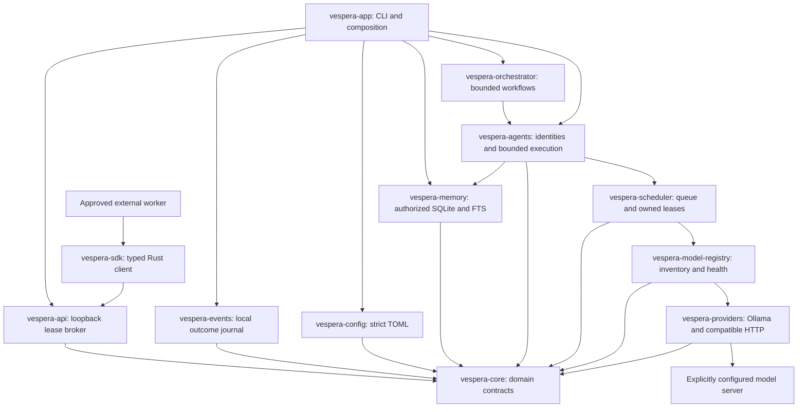

# Vespera

A local-first AI orchestration and simulation platform written in Rust. Vespera separates agent identity from inference models and makes provider health, resource admission, execution ownership and cleanup explicit.

**Development status.** Vespera runs bounded single-agent inference through Ollama and OpenAI-compatible HTTP adapters and serves an authenticated loopback task broker for approved external workers. The twelve-crate workspace has 212 passing offline tests plus the SDK doctest, and Windows release validation. Two bounded live tasks passed against Ollama 0.40.13 using its native and compatible interfaces. Broader lifecycle events, remote interoperability, simulation, native 3D and experiments remain required roadmap work.

[CLI reference](docs/CLI.md) · [Architecture](docs/ARCHITECTURE.md) · [Roadmap](docs/ROADMAP.md) · [Development log](docs/DEVELOPMENT_LOG.md) · [Live evidence](artifacts/live-ollama-2026-11-06.json)

## Architecture and workspace



| Crate | Implemented responsibility |
| --- | --- |
| `vespera-core` | Typed identities, capabilities, task transitions, memory/event contracts and checked resource arithmetic |
| `vespera-config` | Bounded strict configuration, reference validation and endpoint policy |
| `vespera-providers` | Async inference, streaming, cancellation, discovery and explicit lifecycle support |
| `vespera-model-registry` | Independent model inventory, health freshness, lifecycle-safe updates |
| `vespera-scheduler` | Conservative reservations, bounded priority admission, coordinated loading and owned inference leases |
| `vespera-agents` | Independent identities, permissions, bounded in-process memory/messages/history and actual inference |
| `vespera-orchestrator` | Bounded sequential workflows, provenance, retry/failure history and explicit output evaluation |
| `vespera-memory` | Explicit durable namespaces, structured/phrase search, atomic lineage, quotas and process-exit recovery |
| `vespera-api` | Authenticated loopback task service and fenced lease broker for approved external workers |
| `vespera-sdk` | Standalone async Rust clients for operator actions and worker leases |
| `vespera-events` | Local SQLite task outcome journal with bounded retention and cursor replay |
| `vespera-app` | Runtime composition, diagnostics and ten top-level CLI commands |

`config/` contains examples; `docs/` contains subsystem contracts and development records; `artifacts/` contains recorded validation evidence. Local `data/` and `config/local.private.toml` are ignored. No database, server listener or graphical application starts automatically.

## Requirements and installation

The workspace pins Rust **1.99.1**, edition 2024, through `rust-toolchain.toml`. Install [Rust and Cargo](https://rustup.rs/) and Git. Windows MSVC builds also require the Microsoft C++ build tools used by Rust's MSVC toolchain. Cargo fetches locked dependencies during the first build. Vespera needs no Python, Node.js or separate database server. SQLite is bundled through a Rust binding; building it requires a C compiler (MSVC tools on Windows or an equivalent native toolchain).

Windows x86-64 has been built and tested locally; Ubuntu is tested by [GitHub Actions](https://github.com/ShamelesAbyss/Vespera/actions). macOS has not been validated. Offline commands need no model or GPU. Inference requires a separately installed/configured backend, an installed model and operator-supplied RAM/VRAM estimates including context overhead. Hardware suitability depends on that backend and model; `doctor` preserves unknown measurements.

```powershell
git clone https://github.com/ShamelesAbyss/Vespera.git
Set-Location Vespera
cargo build --release --locked -p vespera-app
.\target\release\vespera.exe validate-config --config config/local.toml --json
.\target\release\vespera.exe doctor --json
```

On POSIX shells, use `cd Vespera` and `./target/release/vespera`. All commands can also run as `cargo run --locked -p vespera-app -- <command>`. See the [dependency record](docs/DEPENDENCIES.md) for dependency decisions and licenses.

## Configure providers and models

`config/local.toml` is a safe, offline-valid **placeholder inventory**, not a runnable model installation. Copy it to `config/local.private.toml`. Replace `example-local-model` with an installed provider-native identifier, set accurate capabilities/context/resources and enable the model with `availability = "available"`. The sample agent remains suspended until explicitly resumed for an invocation.

```toml
# Within the selected [[models]] entry; illustrative estimates only.
context_window_tokens = 512
availability = "available"
[models.resources]
ram_bytes = 6442450944
vram_bytes = 6442450944
```

Both resource values are mandatory for admission. Zero VRAM is an explicit CPU-only estimate, not a command forcing CPU execution. Missing estimates block loading. Match `[resources]` budgets to your hardware and backend settings; model disk size does not establish resident RAM. Registering inventory does not load models.

| Provider kind | Configuration and behavior |
| --- | --- |
| `ollama` | Endpoint such as `http://127.0.0.1:11434`; native discovery, inference/streaming, lifecycle and residency observations |
| `open_ai_compatible` | Endpoint such as `http://127.0.0.1:11434/v1`; chat completions/SSE and discovery; explicit load/unload/residency unsupported |
| `custom` | Declaration accepted, but no operational adapter installed |

For a credentialed endpoint, set `credential_env = "VESPERA_PROVIDER_TOKEN"` in its provider entry and supply that environment variable privately. Never put literal credentials in TOML. Offline commands do not resolve credentials. Loopback is the default network policy; remote access requires `network.allow_remote = true`, and plaintext remote HTTP additionally requires `allow_insecure_http = true`. Redirects, embedded URL credentials, query strings and fragments are rejected. See [provider contracts](docs/PROVIDERS.md).

**Context limitation:** the compatible API provides no portable context-allocation control. A live task admitted at 512 tokens caused Ollama's compatible backend to allocate 65,536 tokens. Admission is a logical bound, not proof of backend allocation. Native scheduler-driven preload and inference now both send the admitted context setting; a backend acknowledgement still does not establish measured allocation. External allocations and context-dependent overhead are not yet reconciled into scheduler accounting. These are active engineering gaps, not whole-device capacity guarantees.

## Inspect and execute

| Command | Behavior |
| --- | --- |
| `validate-config` | Offline schema, identity, reference and declaration validation |
| `doctor` | Offline host diagnostics |
| `models` | Offline declared model inventory |
| `agents` | Offline declared agent inventory |
| `provider-health` | Explicit bounded provider health polling, without model loading |
| `run-agent` | One actual bounded agent task, followed by cleanup reporting |
| `run-workflow` | Authorized bounded dependent workflow with attempt/results and cleanup reporting |
| `events` | Initialize, replay or follow a local event journal |
| `memory` | Explicit offline SQLite initialization, write, retrieval, consolidation and deletion |

Every command supports `--help` and `--json`; the root supports `--version`. All except `doctor` accept `--config PATH`, defaulting to `config/local.toml`. The [complete CLI reference](docs/CLI.md) documents every option, range, default, exit behavior and JSON limitation.

```powershell
.\target\release\vespera.exe models --config config/local.private.toml --json
.\target\release\vespera.exe agents --config config/local.private.toml --json
.\target\release\vespera.exe provider-health --config config/local.private.toml --timeout-seconds 30 --json
New-Item -ItemType Directory -Force data | Out-Null
Set-Content -LiteralPath data/task.txt -Encoding utf8 -Value 'Reply briefly with a greeting.'
.\target\release\vespera.exe run-agent --config config/local.private.toml --agent 33333333-3333-4333-8333-333333333333 --prompt-file data/task.txt --resume --max-output-tokens 8 --context-tokens 512 --timeout-seconds 120 --temperature 0 --unload-after --json
```

The example assumes the sample agent UUID was retained and the private inventory has been configured for real hardware/model availability. Prompt files must be nonempty UTF-8 and at most 64 KiB. `--resume` changes status for this invocation only. Generated content is untrusted data and does not execute tools or model instructions.

`--unload-after` explicitly requests unload because a backend may be shared. Omit it when preserving backend residency is intended. Compatible providers cannot acknowledge unload: requesting it can return nonzero even after successful inference. Cleanup reports local draining, acknowledged unloads, remaining estimated reservations and errors. Cancellation does not prove remote computation stopped. CLI task state is not persisted across processes.

## Agents, orchestration and memory

Configure agents in TOML with stable independent UUIDs, identity/personality/goals, permissions and either a fixed model UUID or capability policy. The library supports policy rebinding without replacing identity. Health-aware selection and scheduler admission precede inference. Model names are captured at admission, and task/agent/model/provider/lease provenance accompanies accepted results.

Permissions default to empty. Library memory and inbox operations enforce ownership, provenance, duplicate checks and bounded retention. Defaults are 64 agents, 1,024 retained tasks, 256 memory/inbox records per agent, 64 KiB per text record and 64 MiB aggregate logical retained text. These are in-process bounds, not a durable store or measured heap limit. CLI execution does not automatically inject persona/memory or write memories. Library callers are trusted; UUIDs alone do not authenticate remote actors. See [agents](docs/AGENTS.md) and [durable memory](docs/MEMORY.md). The separate `vespera-memory` library now provides permission-checked SQLite persistence, bounded structured/phrase search and atomic consolidation lineage. Its real agent authorization adapter survives model rebinding and supports reopening under a fresh runtime. The explicit `memory` CLI opens storage for operator requests. Use `run-agent --memory-query-file` to attach authorized durable records and `--remember-result` to save an accepted response. Both are explicit options. See the [CLI reference](docs/CLI.md#opt-in-memory-during-inference).

The orchestrator executes bounded operator-authored workflows with capability routing, authorized delegation, dependency results, capped retries, deadlines and explicit conflict policies. The native `run-workflow` command accepts a strict bounded JSON plan. Automatic decomposition, deterministic simulation and the native 3D command center remain roadmap work. [Orchestrator reference](docs/ORCHESTRATION.md)

## External workers

Run `vespera serve --access-file <path>` to start a loopback service with operator-approved worker IDs, capability grants and signing keys supplied through environment variables. The v2 API uses short-lived HMAC proofs and rejects duplicate nonces. Operators can submit, inspect and cancel tasks and revoke workers. Workers claim, renew and complete fenced attempts with their own keys. Operators and workers can replay broker events or subscribe over WebSocket using the same scoped cursors. Rust clients can use `vespera-sdk`, and other languages can use the documented wire contract. Tasks submitted here execute in the external worker and are separate from `run-agent` and `run-workflow`. Set `--broker-db <path>` to retain tasks, results, revocations and recent event feeds across restarts. Protected remote transport remains roadmap work. [Setup and PowerShell example](docs/CLI.md#external-worker-service) · [Rust SDK](docs/PROTOCOL.md#rust-sdk) · [API contract](docs/PROTOCOL.md#implemented-loopback-worker-api)

To manage durable memory, add `memory_read` and `memory_write` grants to the selected agent's private configuration and initialize its local database:

```powershell
$memoryArgs = @('memory', '--config', 'config/local.private.toml', '--agent', '33333333-3333-4333-8333-333333333333')
.\target\release\vespera.exe @memoryArgs init --json
Set-Content -LiteralPath data/observation.txt -Encoding utf8 -Value 'An observation to retain.'
.\target\release\vespera.exe @memoryArgs add --content-file data/observation.txt --json
.\target\release\vespera.exe @memoryArgs list --json
```

These operations run without a model server. The default database is `data/vespera.sqlite3`; inspection uses a read-only open. The [memory CLI reference](docs/CLI.md#offline-durable-memory) covers all eight subcommands, permissions, filtering and protected lineage deletion.

Run an operator-authored workflow after explicitly granting its coordinator `delegate` in the private configuration:

```powershell
.\target\release\vespera.exe run-workflow --config config/local.private.toml --workflow-file config/workflow.example.json --resume --timeout-seconds 120 --unload-after --json
```

The [example plan](config/workflow.example.json) uses the sample agent for two bounded dependent steps. [Workflow documentation](docs/ORCHESTRATION.md) explains capabilities, attempts, budgets, prior-result handling and explicit conflict policies. A [live native sample](artifacts/live-workflow-2026-11-06.json) completed both steps with acknowledged cleanup. This does not establish semantic correctness or multi-model live compatibility.

## Validation and development

```powershell
cargo fmt --all -- --check
cargo check --workspace --all-targets --locked
cargo test --workspace --locked
cargo clippy --workspace --all-targets --locked -- -D warnings
$env:RUSTDOCFLAGS = '-D warnings'
cargo doc --workspace --no-deps --locked
cargo build --release --workspace --locked
cargo test -p vespera-app --release --locked
```

For POSIX documentation builds use `RUSTDOCFLAGS='-D warnings' cargo doc --workspace --no-deps --locked`. Ordinary tests use local fixtures, require no downloaded model and ignore the explicit live Ollama health test. To opt into that health test against a running local daemon:

```powershell
cargo test -p vespera-providers --test ollama --locked live_ollama_smoke_test -- --ignored
```

[Recorded live evidence](artifacts/live-ollama-2026-11-06.json) covers two nonstreaming tasks on one model/backend version, not a benchmark or broad compatibility matrix. Native execution returned `OK` and acknowledged unload; compatible execution returned `OK` and retained an honest provider-managed reservation. A separate native operator request cleaned up that compatible run. Provider measurements, estimates and client timings are distinguished in the artifact.

Active development is on `main`, the repository default. The previous baseline is preserved on [old-dead-code](https://github.com/ShamelesAbyss/Vespera/tree/old-dead-code).

For contributions, inspect the [roadmap](docs/ROADMAP.md), [architecture](docs/ARCHITECTURE.md), [implementation report](docs/IMPLEMENTATION_REPORT.md) and [development log](docs/DEVELOPMENT_LOG.md). Keep first-party implementation in Rust, maintain acyclic crate boundaries, add meaningful regression coverage, validate intended diffs and record limitations. Verified upgrades are committed and pushed as recoverable checkpoints; do not commit private configuration or credentials.

## Troubleshooting and operational limits

- **Unknown cost or admission rejected:** supply both estimates, check model/context limits and budgets; do not substitute zero for unknown costs.
- **Unhealthy provider:** check the daemon, endpoint policy and credential environment reference with `provider-health`. Inventory alone does not establish health.
- **Suspended agent:** explicitly use `--resume` or change its configured status after reviewing its policy.
- **Unsupported unload:** use the backend's operator controls; an estimate remains charged until supported cleanup is acknowledged. Compatible inference does not imply native lifecycle support.
- **Timeout/cancellation:** inspect structured cleanup and backend activity. The command deadline covers health and execution, with up to five additional seconds for cleanup.
- **Configuration failure:** schema v1 rejects unknown fields, duplicate IDs and broken references. Errors suppress raw configuration and credential values.

Resource accounting is conservative but incomplete: no startup/external allocation reconciliation, per-inference overhead reservation or restart recovery exists yet. Capability routing currently selects the first matching inventory entry rather than ranking resource/context suitability. No production-readiness, comprehensive OS support or performance claim is made. Interactive Ctrl+C delivery has not been manually verified on every OS.

## License

The repository currently reserves all rights; no open-source redistribution license has been granted. See [LICENSE](LICENSE). Third-party dependencies retain their own licenses. Cargo package publication is disabled pending the owner's licensing decision.
