<p align="center">
  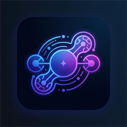
</p>

<h1 align="center">Vespera</h1>

<p align="center"><strong>An Omniverse for Artificial Intelligence</strong></p>

<p align="center">A local-first Rust workspace for running models, coordinating agents, and exploring persistent simulated worlds.</p>

<p align="center">
  <a href="rust-toolchain.toml"></a>
  <a href="https://github.com/ShamelesAbyss/Vespera/actions/workflows/ci.yml"></a>
  <a href="docs/RELEASE.md"></a>
  <a href="LICENSE"></a>
</p>

<p align="center">
  <a href="#getting-started">Get started</a> ·
  <a href="#features">Features</a> ·
  <a href="#commands-and-examples">Commands</a> ·
  <a href="#architecture">Architecture</a> ·
  <a href="#roadmap-and-project-status">Roadmap</a>
</p>

## Overview

Inspired by NVIDIA Omniverse's idea of a shared workspace, Vespera brings AI models, agent identities, compute budgets, workflow execution, and persistent worlds into one local-first environment. Start with a headless CLI or open the native Bevy and wgpu desktop. Both use the same Rust runtime.

An agent keeps its identity when you change its model. The registry records which models are available, the scheduler decides whether a task fits its configured budgets, and the runtime records who performed the work. The Intelligence Atlas visualizes the evidence those systems produce. Living World uses a separate simulation engine and labels simulated state explicitly.

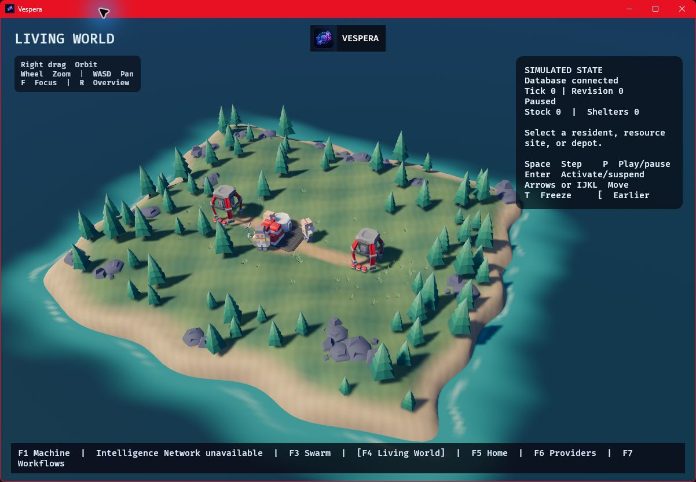

*The starter island at revision 0. Its residents, depot, and resource drills are visible as soon as the scene loads.*

<details>
<summary>Explore the settlement and resident inspector</summary>

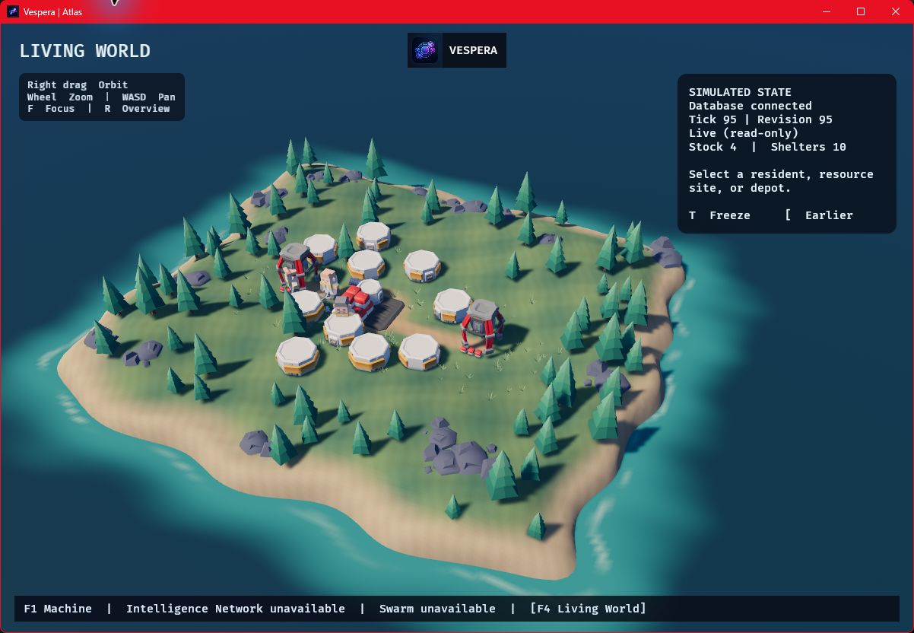

*The example world at revision 95, with ten committed shelters.*

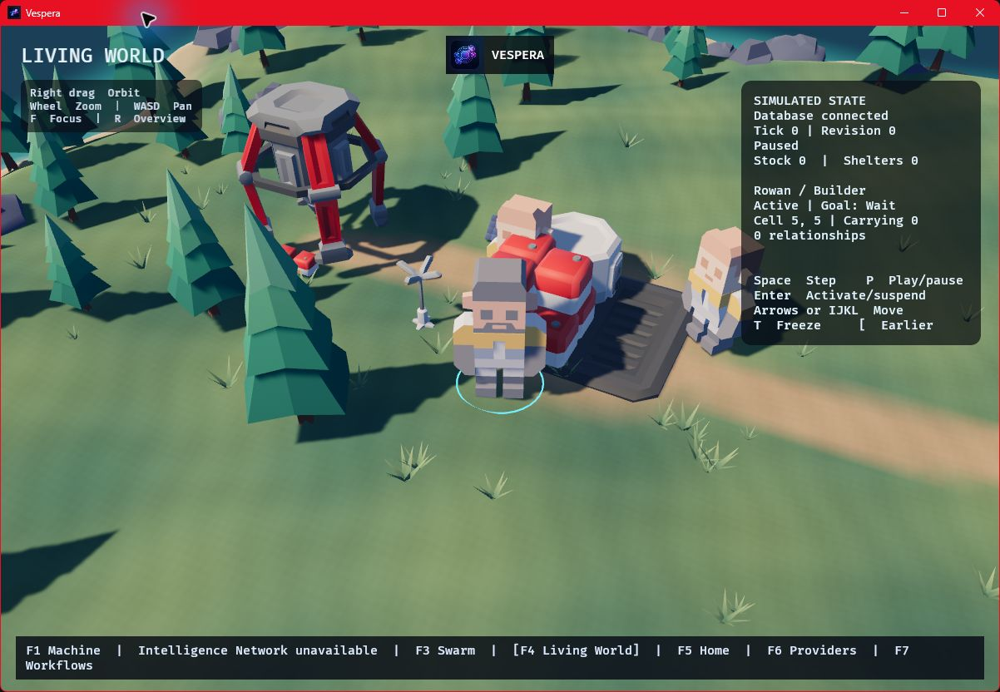

*Camera focus on a builder. The inspector shows the resident's current goal, grid position, inventory, and recorded relationships.* [Controls, measurements, and art credits](docs/WORLD_VISUALS.md)

</details>

<details>
<summary>Inspect broker activity in the Intelligence Network</summary>

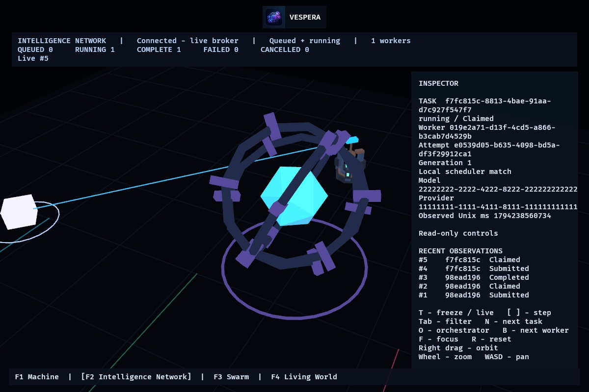

*Captured in the native Windows app while Ollama ran a test task. The inspector shows the local scheduler's model and provider because both the task and worker UUIDs match the signed broker attempt.* [Atlas controls](docs/CLI.md#switch-layers-in-atlas)

</details>

<details>
<summary>Explore three agents in the Swarm Foundry</summary>

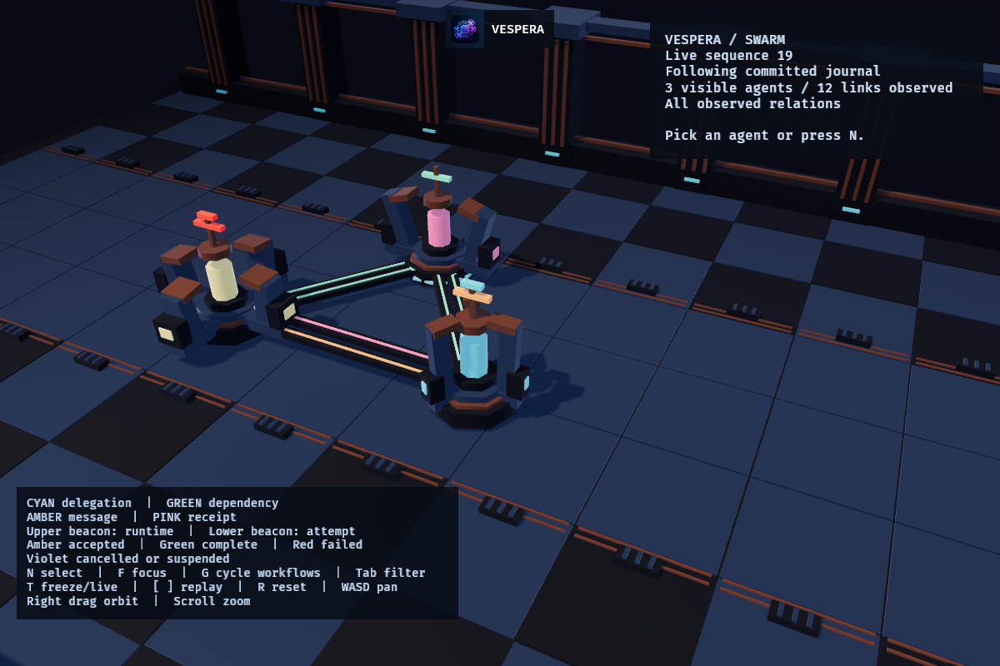

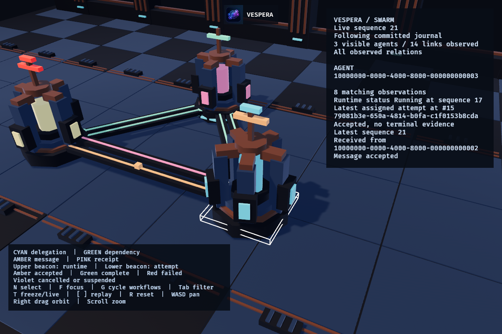

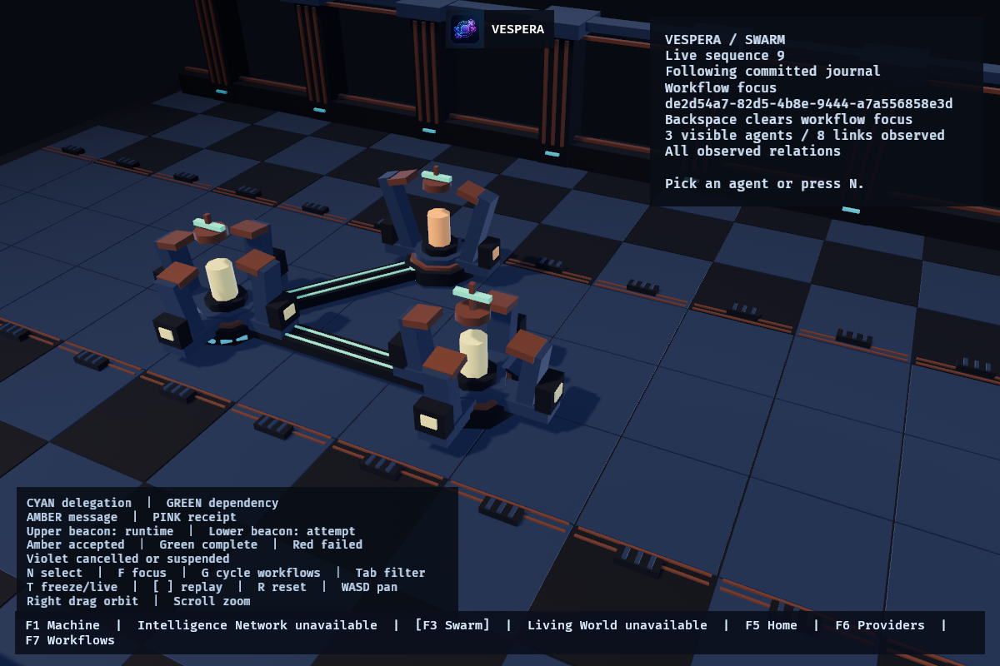

*The overview and message close-up use a synthetic journal. The final capture shows the retained journal of a four-step workflow authored and executed in the Windows app with Ollama.* [Swarm controls and fixture](docs/CLI.md#swarm-view)

</details>

<details>
<summary>See a completed two-agent desktop workflow</summary>

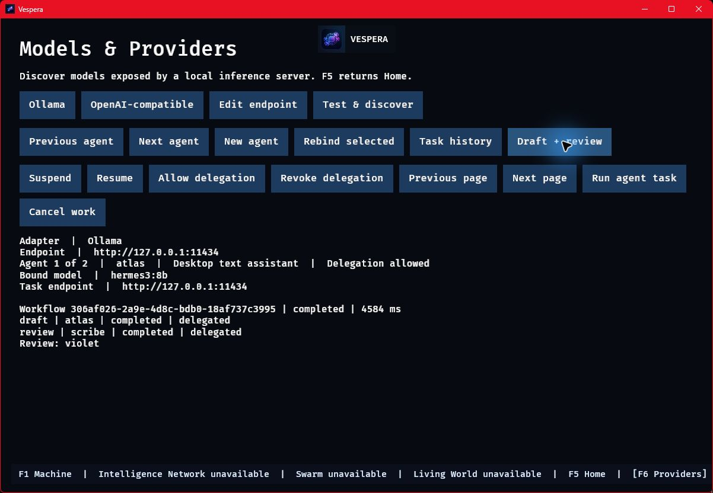

*Captured during the live Ollama walkthrough. The panel shows the observed draft, delegated review, and returned result.* [Validation record](docs/DEVELOPMENT_LOG.md#2026-11-07--delegated-desktop-workflow)

</details>

## Features

| Area | What you can use today |
| --- | --- |
| **Providers** | Native Ollama and OpenAI-compatible HTTP adapters with bounded chat, streaming, health and discovery. LM Studio Bionic has live compatibility evidence. Native Ollama also supplies model metadata, supported load and unload, and residency observations. [Provider contracts](docs/PROVIDERS.md) |
| **Model inventory and compute** | Strict TOML or a revision-fenced SQLite model catalog. Bounded priority queues, owned leases, context limits, explicit RAM and VRAM estimates, optional host ceilings and Ollama residency reconciliation. [Registry](docs/REGISTRY.md) · [Scheduler](docs/SCHEDULER.md) |
| **Agents and orchestration** | Stable identities, fixed or capability-based model policies, permission-gated delegation, operator holds, durable tasks and inboxes. Run an authored workflow or bounded model-assisted decomposition. The desktop supports up to 16 saved agents, same-provider draft and review, and an editor for workflows with explicit dependencies. [Agent runtime](docs/AGENTS.md) · [Orchestration](docs/ORCHESTRATION.md) |
| **Persistent memory and events** | Private SQLite memory namespaces, bounded phrase retrieval, consolidation with lineage, backup and restore, and opt-in memory context. A separate event journal retains sanitized observations with cursors and checkpoint recovery. [Memory](docs/MEMORY.md) · [Events](docs/CLI.md#local-task-outcome-journal) |
| **External workers** | An authenticated broker and Rust SDK with signed HTTP actions, fenced leases, cancellation, scoped replay and live WebSockets. Broker SQLite recovery and opt-in TLS are available. [Implemented protocol](docs/PROTOCOL.md#implemented-loopback-worker-api) |
| **Intelligence Atlas** | Machine shows host and opted-in scheduler evidence. Intelligence Network shows signed broker tasks and workers. Swarm follows committed desktop workflow observations, or reads delegation, dependencies and messages from configured sources. Select, inspect, navigate and replay retained evidence. [Atlas controls](docs/CLI.md#switch-layers-in-atlas) |
| **Living World** | Explore a seeded 3D coastal settlement with textured buildings and articulated residents. Select foragers, builders, the depot, or resource drills. Committed state drives movement, stock, and shelters. Step, play, replay retained revisions, or authorize bounded model-assisted decisions. [Native viewer](docs/WORLD_VISUALS.md) · [Simulation commands](docs/CLI.md#persistent-world-simulation) |
| **Experiments** | Compare deterministic world policies or paired local Ollama models, retrieval policies and authored workflows. Reports separate observed timings, outcomes and missing measurements. [Experiment commands](docs/CLI.md#compare-two-world-policies) |

The OpenAI-compatible adapter leaves explicit load, unload and residency to the provider. Vespera uses its logical context budget for admission. The desktop provider panel connects to loopback endpoints and can use credentials supplied through environment-variable references. An authenticated OpenAI-compatible fixture verified discovery and execution from a saved desktop binding. [Context and lifecycle evidence](docs/PROVIDERS.md#resource-observations-and-lifecycle)

## Getting started

### Requirements

| Target | Requirements and verification |
| --- | --- |
| **Windows x64** | Rust and Cargo, Git, and Visual Studio C++ Build Tools with the Windows SDK for source builds. The native desktop and per-user installer have been exercised on Windows. |
| **Linux** | Rust and Cargo, Git, and a native C toolchain for bundled SQLite. Ubuntu CI covers the headless workspace. The desktop needs X11, the `libxkbcommon-x11` runtime, and a working wgpu adapter. Ubuntu WSLg passed a software-rendered Living World walkthrough. [Linux validation](docs/RELEASE.md#linux-desktop-validation) |
| **macOS** | The repository includes a derived ICNS asset. Native packaging and desktop behavior still need platform verification. |
| **Model inference** | A separately running supported provider, an installed model and credible resource estimates. Headless diagnostics and deterministic world simulation need no model or GPU. |

The workspace pins Rust **1.99.1**. A fresh source build needs access to locked dependencies. After they are cached, add `--offline` to Cargo commands. There is no separate database server. [Dependency record](docs/DEPENDENCIES.md)

### Windows installer or portable build

For an internal build, follow the release walkthrough to stage and verify the Windows package. Run the resulting `Vespera-Setup.exe` for a per-user install with Start Menu and desktop shortcuts. For a portable candidate, open `bin\vespera-launcher.exe`. The installer and portable build include the official icon and assets. [Build and verify a local package](docs/RELEASE.md)

### Run from source

<details open>
<summary>Windows PowerShell</summary>

```powershell
git clone https://github.com/ShamelesAbyss/Vespera.git
Set-Location Vespera
cargo build --release --locked -p vespera-app
.\target\release\vespera.exe doctor --json
cargo run --locked -p vespera-view --features graphics --bin vespera-view
```

</details>

<details>
<summary>Linux shell</summary>

```bash
git clone https://github.com/ShamelesAbyss/Vespera.git
cd Vespera
cargo build --release --locked -p vespera-app
./target/release/vespera doctor --json
cargo run --locked -p vespera-view --features graphics --bin vespera-view
```

</details>

### Run your first desktop task

1. Start Ollama or a compatible local server with a text model available. Open Vespera and choose **Models & Providers**.
2. Choose the adapter, check the endpoint, and select **Test & discover**. The default native Ollama URL is `http://127.0.0.1:11434`. The compatible preset uses `http://127.0.0.1:1234/v1`, which can be edited.
3. Choose **New agent** and press the number next to an exposed model. Enter the agent name, role, and credible RAM and VRAM estimates in MiB.
4. Choose **Run agent task** or press **P**, enter a short prompt, and press **Enter**. Open **Task history** to inspect the saved outcome.

For an authenticated loopback server, choose **Credential reference** to use a launch environment variable. On Windows, **Windows credential** can read a generic credential provisioned in Windows Credential Manager for that adapter and endpoint. [Provider setup](docs/CLI.md#discover-local-models-in-the-desktop)

Home opens Hardware and a starter world before any provider is configured. **M** on Home toggles the saved reduced-motion preference. **F5** returns Home and **F6** opens Models & Providers. Grant delegation to a coordinator, then use **G** for **Draft + review** or **C** to author and revise a workflow with two to six steps and explicit dependencies. **F7** opens retained checkpoints. From there you can focus Swarm on a run or open its plan as an editable copy. [Desktop walkthrough](docs/CLI.md#open-the-native-desktop) · [Workflow builder](docs/CLI.md#author-a-desktop-workflow) · [Workflow history](docs/CLI.md#browse-retained-desktop-workflows)

On Windows x64, **Check for updates** on Home looks for a newer eligible
official release. A standard per-user installation with an approved signer
fingerprint can download and verify Setup, then open it after Vespera shuts
down. Development builds without a fingerprint use manual installation.
[Update channel requirements](docs/RELEASE.md#desktop-update-channel)

To explore the island, choose **Create or resume world** on Home. Right-drag to orbit, scroll to zoom, and use **WASD** to pan. Click an entity to inspect it. **F** focuses the camera and **R** returns to the overview. **Space** commits one tick and **P** toggles playback. [Living World controls and replay](docs/WORLD_VISUALS.md)

## Commands and examples

Examples using `cargo run` work in PowerShell and Linux shells unless marked otherwise. The command reference covers flags, outputs, prerequisites and recovery. [CLI reference](docs/CLI.md)

### Inspect and configure

```sh
cargo run --locked -p vespera-app -- validate-config --config config/local.toml --json
cargo run --locked -p vespera-app -- models --config config/local.toml --json
cargo run --locked -p vespera-app -- agents --config config/local.toml --json
cargo run --locked -p vespera-app -- provider-health --config config/local.toml --timeout-seconds 30 --json
```

The checked-in TOML is a placeholder inventory. For inference, copy it to `config/local.private.toml`, select an installed provider-native model identifier, declare capabilities and memory estimates, and enable the model. Keep the sample agent UUID to use the example below. The health check contacts the daemon without loading a model. [Configure a real model](docs/CLI.md#run-one-agent-task)

<details>
<summary>Run and inspect a durable CLI task</summary>

PowerShell:

```powershell
New-Item -ItemType Directory -Force data | Out-Null
Set-Content -LiteralPath data/task.txt -Encoding utf8 -Value 'Reply with a short greeting.'
cargo run --locked -p vespera-app -- run-agent --config config/local.private.toml --agent 33333333-3333-4333-8333-333333333333 --prompt-file data/task.txt --task-store data/agent-tasks.sqlite3 --resume --max-output-tokens 32 --json
```

Linux:

```bash
mkdir -p data
printf '%s\n' 'Reply with a short greeting.' > data/task.txt
cargo run --locked -p vespera-app -- run-agent --config config/local.private.toml --agent 33333333-3333-4333-8333-333333333333 --prompt-file data/task.txt --task-store data/agent-tasks.sqlite3 --resume --max-output-tokens 32 --json
```

Use the returned task UUID with `agent-task-history --database data/agent-tasks.sqlite3 --task <UUID>`. The example's `--resume` activates the agent for the invocation. A durable operator hold must be released separately. [Task history and holds](docs/AGENTS.md#durable-task-ownership)

</details>

<details>
<summary>Run an authored workflow and reopen its checkpoint</summary>

Configure the sample agent as above and give the coordinator the `delegate` permission in your private TOML. The shipped example uses that agent for both steps. For distinct agents, use a plan naming their configured IDs.

```sh
cargo run --locked -p vespera-app -- run-workflow --config config/local.private.toml --workflow-file config/workflow.example.json --workflow-store data/workflows.sqlite3 --task-store data/agent-tasks.sqlite3 --resume --timeout-seconds 120 --json
cargo run --locked -p vespera-app -- workflow-history --database data/workflows.sqlite3 --task 77777777-7777-4777-8777-777777777777
```

The sample plan has a fixed task UUID. To run it again against the same history, author a plan with a fresh root UUID. Use `--decomposition-file` for a bounded planning request with an explicit roster. [Workflow execution and recovery](docs/CLI.md#execute-a-workflow)

</details>

### Create, advance and open a world

Create the `data` directory first with `New-Item -ItemType Directory -Force data` in PowerShell or `mkdir -p data` in Linux. Choose a fresh database for initialization.

```sh
cargo run --locked -p vespera-app -- world --database data/world.sqlite3 init --spec config/world.example.json
cargo run --locked -p vespera-app -- world --database data/world.sqlite3 advance --ticks 8
cargo run --locked -p vespera-app -- world --database data/world.sqlite3 replay --revision 8
cargo run --locked -p vespera-view --features graphics --bin vespera-view -- --world data/world.sqlite3
```

A standalone World view starts read-only. With `--allow-world-control`, **Space** commits a tick and **P** toggles playback. Press **T** to freeze or return live, and **[** or **]** to step through retained commits. Right-drag orbits, the wheel zooms, and **WASD** pans. [World controls and model decisions](docs/CLI.md#graphical-world-controls)

<details>
<summary>Open Atlas layers and run a paired simulation experiment</summary>

```sh
cargo run --locked -p vespera-view --features graphics --bin vespera-view -- --atlas --world data/world.sqlite3
cargo run --locked -p vespera-view --features graphics --bin vespera-view -- --machine
cargo run --locked -p vespera-app -- experiment-world --spec config/world.example.json --evidence-dir target/world-policy-evidence --ticks 60 --seeds 3 --suspend-role forager --target-shelters 5
```

Use a fresh experiment evidence directory. **F1–F4** select configured Atlas layers. Add `--broker 127.0.0.1:8765` for Intelligence Network with a running broker and privately supplied `VESPERA_OPERATOR_TOKEN`. For a TLS broker, add `--broker-tls-ca <PEM>` with an explicit broker IP and port; certificate verification remains required. A local journal can be opened with `--swarm <PATH>`. [Atlas sources](docs/CLI.md#switch-layers-in-atlas) · [Experiment scope](docs/CLI.md#compare-two-world-policies)

</details>

<details>
<summary>Command map</summary>

| Work | Commands |
| --- | --- |
| Configure and diagnose | `validate-config`, `doctor`, `models`, `agents`, `catalog`, `provider-health` |
| Execute and recover | `run-agent`, `agent-state`, `agent-task-history`, `agent-inbox`, `run-workflow`, `workflow-history` |
| Store and observe | `memory`, `memory-admin`, `events`, `serve` |
| Simulate and compare | `world`, `experiment-world`, `experiment-models`, `experiment-workflows` |

Use `--help` on any command or subcommand. The desktop executable also has `--help`. [Full command reference](docs/CLI.md)

</details>

## Real-world use cases

- **Local AI research.** Compare two installed Ollama models on the same private cases. Read the outcomes alongside provider observations and cleanup evidence.
- **Multi-agent collaboration.** Assign a drafter and reviewer to different saved identities. Inspect who ran each step and recover the exact dependency evidence from the workflow store.
- **Resource-constrained inference.** Give a task a small context and output budget, set model estimates, and use Machine to inspect the scheduler's decision.
- **Persistent AI memory.** Write records to an agent-owned namespace and compare responses with and without authorized retrieval. The same namespace follows the agent across model changes.
- **Artificial world simulation.** Replay a seeded world, then vary resident availability and compare changes in resources and shelters.

## Architecture

The desktop and CLI compose the same execution stack. The broker gives external workers a separate authenticated path. World state, task history, private memory and observation events each have their own storage boundary.

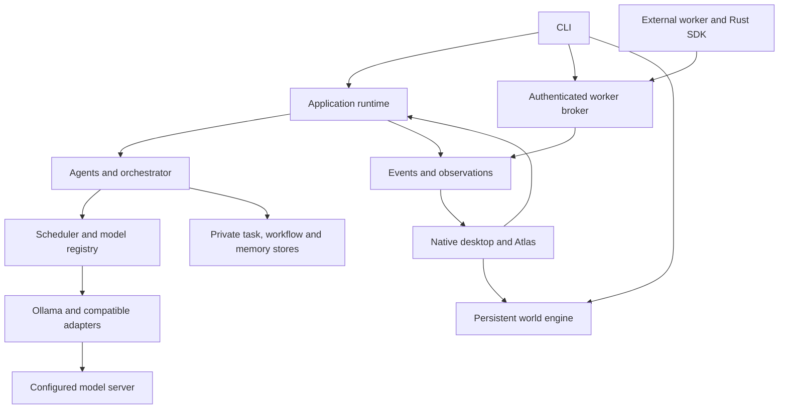

<details>
<summary>Follow a bounded inference request and explore the workspace</summary>

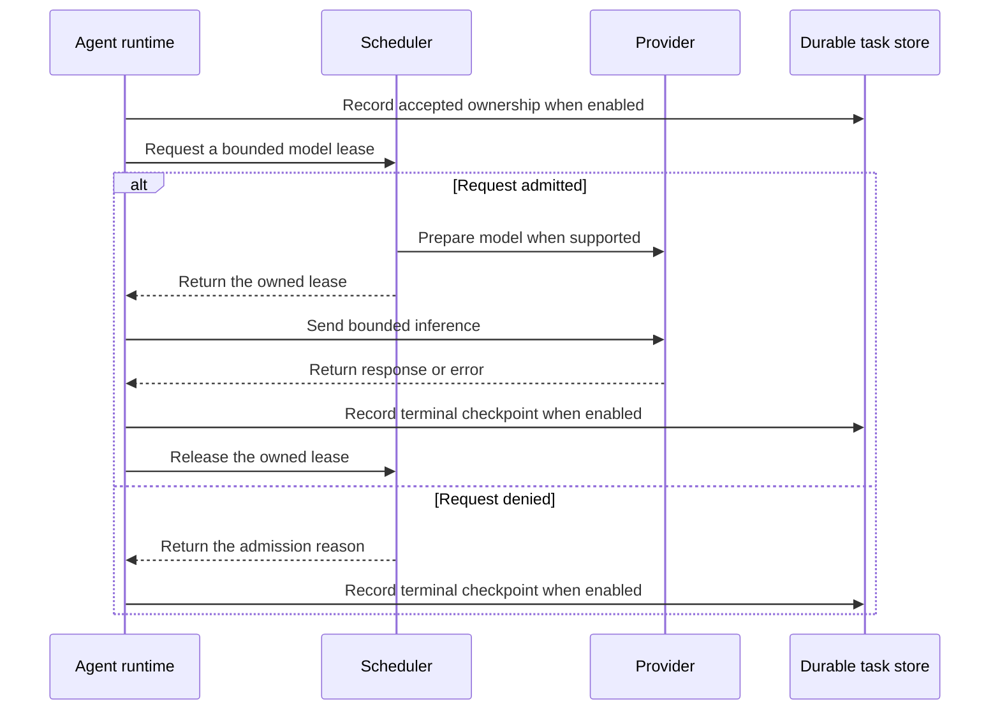

| Workspace crates | Responsibility |
| --- | --- |
| `vespera-core`, `vespera-config` | Domain contracts, strict configuration and endpoint declarations |
| `vespera-app`, `vespera-view` | Shared application composition, CLI, launcher and native desktop |
| `vespera-providers`, `vespera-model-registry`, `vespera-scheduler` | Provider contracts, inventory and health, queues and model leases |
| `vespera-agents`, `vespera-orchestrator` | Stable identities, execution, permissions and bounded workflows |
| `vespera-memory`, `vespera-events`, `vespera-world` | Private retrieval, observation journal and persistent simulation |
| `vespera-api`, `vespera-sdk` | Worker and operator broker protocol and Rust client |

`config/` contains runnable specifications and placeholder inventory. `docs/` holds contracts and release procedures. `artifacts/` records validation evidence, and `packaging/windows/` defines the installer. [Architecture guide](docs/ARCHITECTURE.md)

</details>

## Configuration and security

- **Providers.** Use `ollama` for native lifecycle support and `open_ai_compatible` for compatible chat and discovery. The `custom` declaration has no installed adapter. Configure credential references with `credential_env = "VESPERA_PROVIDER_TOKEN"` in a private configuration and supply the value outside the file. [Endpoint policy](docs/PROVIDERS.md#endpoints-and-credentials)
- **Permissions.** New desktop agents have no optional grants. Delegation, memory, communication and simulation actions use explicit permission checks. Model outputs and retrieved text are treated as untrusted input. [Agent grants](docs/AGENTS.md)
- **Network.** Providers and broker default to loopback. Remote provider access and remote broker TLS are explicit operator settings. The broker derives scoped authority from signed requests and fenced leases. [Authentication and routes](docs/PROTOCOL.md#request-authentication) · [TLS](docs/CLI.md#tls-worker-transport)
- **Storage.** The desktop uses a per-user data directory, separate from the installation. Task, workflow and memory files can contain private prompts, responses and records. Back up while writers are stopped, keep related SQLite sidecars with the backup, and use the memory backup command where applicable. [Desktop data](docs/CLI.md#open-the-native-desktop) · [Backup and recovery](docs/RELEASE.md#upgrade-and-recovery)

## Development and testing

```sh
cargo fmt --all -- --check
cargo check --workspace --all-targets --locked
cargo test --workspace --locked
cargo clippy --workspace --all-targets --locked -- -D warnings
```

The default workspace commands are headless. Check graphics separately on a host with the platform build tools.

```sh
cargo build --locked -p vespera-view --features graphics
cargo test --locked -p vespera-view --features graphics
cargo clippy --locked -p vespera-view --features graphics --all-targets -- -D warnings
```

The offline suites use local fixtures. Opt-in live tests require their named daemon and model. Record OS, adapter, backend, model and observed result when reporting a live check. [Provider test matrix](docs/PROVIDERS.md#verification-and-live-scope) · [Development log](docs/DEVELOPMENT_LOG.md)

## Troubleshooting

| Symptom | What to check |
| --- | --- |
| **The Windows build cannot find `rc.exe`** | Install the Windows SDK and MSVC C++ tools. The graphics build compiles the embedded icon as a Windows resource. |
| **The app opens but a layer is unavailable** | Atlas layers follow configured sources. Home can open a local world and desktop Swarm directly. Use the explicit broker or journal flags for additional sources. |
| **Provider health fails or the model list is empty** | Check the daemon, the adapter and endpoint path. Discover models from the desktop or run `provider-health` with the private configuration. |
| **Admission rejects a task** | Check both RAM and VRAM estimates, the configured budget, requested context and external residency. Zero VRAM is an explicit CPU-only estimate and does not force backend placement. |
| **A held agent cannot start** | Resume the selected agent in the desktop or release its durable hold with `agent-state`. An invocation-only resume cannot clear a hold. |
| **Cancellation or unload is unconfirmed** | Check the cleanup report and provider activity. Compatible servers manage their own residency. Native unload acknowledgements and device measurements are separate observations. |
| **The renderer cannot start** | Check the display server and GPU driver. The CLI and deterministic experiments remain available without graphics. |

## Roadmap and project status

Vespera is under active development. The Windows desktop has verified Home, hardware inspection, persistent world controls, native and compatible inference, durable agent history, branded installation and a live two-agent workflow. Headless tests run in Ubuntu CI.

The `0.1.2` Windows x64 internal candidate passed portable and installer payload verification, native launch, and portable rollback from `0.1.1`. The earlier `0.1.1` walkthrough covered all four Atlas views and a per-user MSI install, upgrade, and restore. A Windows SDK client also verified authenticated TLS recovery with an Ubuntu WSL2 broker on the same physical machine. [Candidate validation](docs/RELEASE.md#validated-windows-x64-candidate) · [TLS rehearsal](docs/PROTOCOL.md#rehearse-a-non-loopback-tls-deployment)

The rebuilt Living World was exercised from Home and Atlas on Windows. At 1200×800 on an RTX 4070 Laptop GPU, the development build recorded p95 update intervals of 11.63 ms for the example settlement and 12.66 ms for a 64×64 fixture. The samples cover steady views on that adapter. [Fixture details and measurement scope](docs/WORLD_VISUALS.md#windows-validation)

| Next area | Work underway or still open |
| --- | --- |
| **Desktop and Atlas** | Broader workflow authoring, OS-backed credential management, and persistent settings |
| **Hardware and interoperability** | Broader GPU and operating-system coverage, independent-machine TLS validation, and wider provider qualification |
| **Release** | Legal review for public distribution, third-party rights and notices, signing, a supported production installer toolchain, and macOS packaging |

[Milestone ledger](docs/MILESTONE_LEDGER.md) · [Roadmap](docs/ROADMAP.md) · [Verified checkpoints](docs/DEVELOPMENT_LOG.md)

For contributions, start with the architecture and relevant contract, preserve the headless and native entry points, and include scoped validation evidence. Keep credentials, private TOML, model outputs and user databases out of commits. Development lands on `main`. The original baseline is retained on [old-dead-code](https://github.com/ShamelesAbyss/Vespera/tree/old-dead-code).

**License.** Christopher Dodd approved the Vespera Proprietary Freeware License v1.0 as the project’s software licensing policy. It permits free personal, educational, research, and commercial use of authorized official builds released under its terms, including monetizing independent projects and integrations. Users retain their rights in their data and work. Vespera’s modification and redistribution rights remain reserved, subject to applicable law and separate component licenses. Public distribution remains subject to the release gates. [License](LICENSE) · [Third-party notices](THIRD_PARTY_NOTICES.md) · [Release scope](docs/RELEASE.md)

### User-Controlled AI and Responsibility

Vespera is a general-purpose, local-first AI orchestration and simulation platform. Users choose, install, configure, and operate their models, including unrestricted third-party models, and control the tools, permissions, and workflows they authorize.

Vespera does not require model-level content filtering or endorse the behavior of connected models. Users are responsible for their deployments, authorized actions, generated outputs, and compliance with applicable law and third-party terms. The license sets out the applicable warranties and liability limits and preserves non-waivable legal obligations. [Vespera Proprietary Freeware License v1.0](LICENSE)
