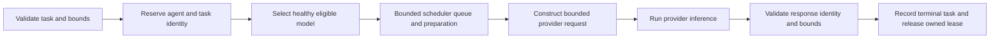

# Agent runtime

An agent has an independent UUID, identity, role, personality, goals, replaceable
model policy, permissions and operational state. The Rust runtime registers and
inspects agents, routes by fixed model or declared capabilities, coordinates
owned task execution, and provides permission-gated in-process memory/messages.
It is not yet a persistent autonomous ecosystem or an external-agent server.

## Actual task inference

`AgentRuntime::execute_task(agent_id, task, options, cancel)` executes one bounded
provider inference through the selected model and scheduler lease. It returns a
`TaskExecutionResult` containing the terminal task snapshot, agent/model/provider
IDs, unique lease identity, response/finish reason/provider metrics, and
runtime-observed elapsed time including queueing and loading.

The lifecycle is:



An agent can prepare/run only one task at a time. Accepted task IDs cannot be
overwritten or revived. Delegation records a queued task for a specific recipient;
that recipient can execute the unchanged task once. Provider-native model names
are captured at admission, so a later registry edit cannot silently retarget an
accepted request.

`ExecutionOptions` defaults to 256 output tokens, model/scheduler-limited context,
a 60-second total task budget, no explicit temperature and a 256-KiB accepted
response content limit. Limits are validated before execution. The task deadline
includes queue, preparation and inference; it is separate from transport limits.
Provider/model identity mismatches, excessive content/reported output tokens and
unsupported tool/lifecycle responses fail the task. Unknown finish reasons remain
unknown. A completed inference does not certify that generated claims are correct
or that a broader objective was achieved. Length-limited output retains its
reported finish reason.

Only the task prompt is currently supplied as a user message. Personality, goals
and stored memory are not automatically injected. Output is returned to the
caller, not automatically stored as memory or executed as actions. Persistent
result history, bounded memory context assembly, tool execution and autonomous
multi-step behavior remain integration work.

## Cancellation, failure and ownership

Caller cancellation and `cancel_task(task_id)` request local cancellation.
`cancel_task` returns false when the task exists but no managed invocation remains.
It signals the owned invocation rather than releasing its lease prematurely.
`finish_task_execution` cannot finish a managed task while provider work is active.

A synchronous execution guard records cancellation and releases the local slot
when a running future is dropped/aborted, including an uncooperative provider.
The total task deadline also cancels local execution. Provider errors and invalid
responses record failure. Agents return to idle after completion/cancellation;
failure requires an operator status change before retrying with a new task ID.
Cancellation does not prove remote compute stopped; provider memory reservations
remain charged until the scheduler has acknowledged unload evidence.

The lower-level `start_task_execution`/`finish_task_execution` pair remains for
trusted composition. A caller choosing that API must finish its accepted task;
the managed `execute_task` method owns cancellation/abort cleanup for the whole
invocation. Completion validates the recorded model and unique lease before
releasing anything. Duplicate/wrong-model completion cannot release another task.

## Operator authority and permissions

Identity, permissions, model policy and status are control-plane owned. Model
output cannot modify them. Model-policy rebinding retains identity and memory;
rebinding/status changes cannot bypass active execution, and registration cannot
fabricate a running agent.

The default permission set is empty. Current variants are `communicate`,
`memory_read`, `memory_write`, `delegate`, and `simulation_act`. Memory reads and
writes, message sends and inbox reads, delegation, and simulation authorization
check the corresponding grant. `simulation_act` authorizes a future action; no
world engine exists yet. There is no tool executor or OS sandbox in this runtime.

These Rust library methods assume a trusted caller supplies the correct actor ID.
They are not a remotely authenticated principal boundary. Future API/external
agent composition must derive actor identity from authenticated authority, never
accept an arbitrary agent UUID as proof of identity. Provider network authorization
is operator configuration, not authority conferred by model text.

## Memory and communication limits

Memory and inbox records live in per-agent in-process maps. They do not survive
restart and do not implement full-text search/consolidation. `RuntimeLimits`
defaults to 64 agents, 1,024 accepted task records (including terminal history),
256 memories per agent, 256 messages per inbox, 64 KiB of text per record and
64 MiB of aggregate retained textual content. `with_limits` accepts positive
operator bounds; `usage_snapshot` exposes counts and logical content accounting.
These are storage-policy bounds, not measured host RAM: allocations, IDs,
provider state and caller-owned snapshot clones are separate overhead.

Writes and policy replacement check capacity before changing state. Full stores
reject new records rather than silently deleting provenance. Accepted delegated
tasks are charged once when later dispatched. Memory IDs cannot be reused across
namespaces. A memory task source must be a known task assigned to that owner;
a message task correlation must belong to its sender or recipient. A valid
reference does not certify the generated content or imply task completion.
No pruning/retention worker is implemented yet. Durable isolated storage remains
required work. See
[MEMORY.md](MEMORY.md) and [ROADMAP.md](ROADMAP.md).

## Verification

```powershell
cargo test -p vespera-agents --locked
```

Deterministic fake providers verify actual invocation, transmitted bounds,
provenance, invalid/failing responses, task ownership, model-policy independence,
permission checks, duplicate delegation, concurrent preparation, managed/manual
completion fencing, queue/load/inference cancellation, absolute deadlines and
future abort. CLI integration additionally verifies the executable-to-HTTP path
against both adapter fixtures. This is not live inference evidence for a
particular installed model/server. See [CLI.md](CLI.md) for actual operation.

Managed execution validates the selected model name, input and output/context bounds before scheduler admission can load a model. Accepted invalid requests become failed history records with no load/reservation. Scheduler request admission fences the validated native name and pins context; current inventory and resource limits are rechecked before lifecycle I/O. Manual preparation remains a lower-level trusted API.

The [orchestrator library](ORCHESTRATION.md) now drives actual authorized dependent workflows. It preserves failure states, never implicitly resumes failed/suspended candidates and uses a synchronous owner-checked queued-task cancellation operation for drop cleanup. CLI workflow submission and autonomous planning remain pending.
