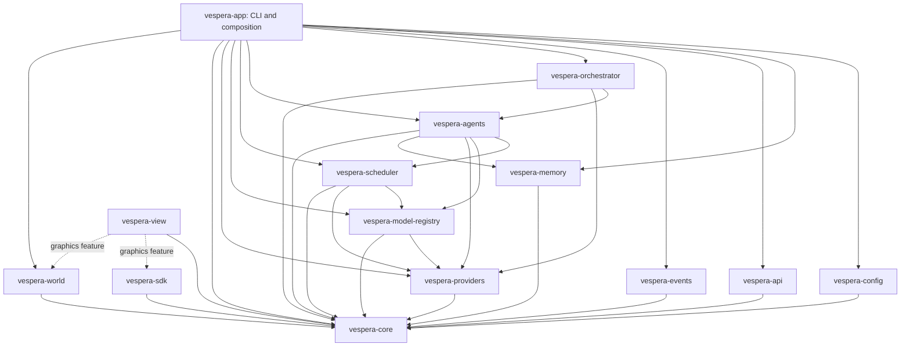

# Architecture

Vespera is a local-first Rust orchestration and simulation platform under active
implementation. The current fourteen-crate workspace connects configuration,
provider HTTP adapters, a model registry, resource scheduling and independent
agent execution through a native CLI. It also provides bounded sequential
workflows, SQLite memory and task events, and an authenticated worker service with a
Rust SDK and opt-in TLS, directed worker mailboxes, and a native 3D view of
observed broker activity. A separate SQLite world engine advances deterministic
resident actions and shared resources through logical ticks. Automatic orchestration,
complete orchestration visualization and experimentation remain required milestones.

## Current workspace

Arrows mean compile-time dependencies; the graph is acyclic.

| Crate | Implemented responsibility |
| --- | --- |
| `vespera-core` | Typed IDs/capabilities, independent agent/model contracts, task transitions, checked resource arithmetic, memory addressing, versioned event envelopes |
| `vespera-config` | Size-bounded strict TOML, domain/reference/duplicate validation, local-first declarations |
| `vespera-providers` | Object-safe async contract; Ollama and OpenAI-compatible adapters; explicit unsupported capabilities; bounded direct HTTP/streaming |
| `vespera-model-registry` | Atomic registration/update/removal, immutable bindings, effective expiring health, selected polling, stale-result fencing |
| `vespera-scheduler` | Conservative reservation admission, per-model lifecycle gates, owned leases, acknowledged unload, bounded priority/fairness queue and shutdown drain |
| `vespera-agents` | Independent identity, permission-gated bounded records/messages, task source ownership, actual bounded inference, cancellation/deadline/abort cleanup |
| `vespera-orchestrator` | Authorized bounded workflow routing/delegation, attempts, dependencies, cancellation and explicit output/conflict policy |
| `vespera-api` | Bounded HTTP service with role-separated credentials, fenced task attempts and optional TLS |
| `vespera-sdk` | Async client for v2 operator and worker actions, scoped event replay and WebSocket subscriptions |
| `vespera-view` | Optional Bevy Machine, Intelligence Network, Swarm and simulation views with picking, inspection and confirmed broker cancellation. Machine can read runtime telemetry. Swarm follows committed typed observations in a local event journal. |
| `vespera-world` | Deterministic simulation domain and SQLite state independent of graphics and providers |
| `vespera-events` | Local SQLite task outcome journal, transactional retention and scoped replay cursors |
| `vespera-memory` | Explicit authorized SQLite storage, FTS, lineage, owner-local pagination, transactional quotas and recovery |
| `vespera-app` | Library composition plus offline inspection, explicit health checks and agent/workflow execution and offline memory CLI operations |

`vespera-app::runtime` owns composition. CLI handlers perform bounded input/output
and call application services; provider/scheduler/agent logic remains outside
argument handlers. `from_config` composes the complete declared runtime;
`from_config_for_agent` composes only one agent and its candidate inventory after
validating the complete source configuration. Neither sends provider requests
or activates models during construction, though constructors resolve referenced
credentials. Offline CLI commands bypass adapter construction entirely.

## Execution and concurrency invariants

The operator owns agent identity, permissions and model policy. A model replacement
retains the agent UUID and memory owner. Generated text never becomes authority.
The current library assumes a trusted caller supplies actor IDs; a future API must
derive them from authentication rather than accepting UUIDs as credentials.

Accepted agent/task reservation is atomic before asynchronous preparation. Only
one task prepares/runs per agent. Task IDs cannot overwrite or revive prior
history. A delegated task must start unchanged for its recorded recipient.
Managed execution captures the admitted provider/model binding, sends a validated
request, validates result provenance/bounds, records a legal terminal state and
releases only its unique lease. Manual completion cannot release a managed task
while provider work is active.

Registry locks never span network I/O. Scheduler accounting uses a short
synchronous mutex and separate per-model asynchronous gates; no global accounting
lock spans provider load/unload. Concurrent same-model loads coordinate. An
interrupted transition keeps uncertain provider memory charged, and only a
matching acknowledgement frees an unload reservation. Owned queue/lease guards
handle dropped futures synchronously, without detached cleanup workers.

## Resources and lifecycle knowledge

Inventory presence, operator enablement, provider health, model readiness,
reservation, acknowledged load and measured residency are distinct. Provider
health is not model-specific readiness. Estimates remain unknown until supplied;
unknown RAM or VRAM costs reject admission. Explicit zero VRAM is CPU-only policy,
not proof that a daemon is actually configured for CPU execution.

Reservations are estimates supplied by the operator, not measured free hardware.
The scheduler bounds concurrency, queue capacity, context and aggregate reserved
RAM/VRAM. Per-request KV-cache costing, external allocation reconciliation,
headroom discovery and restart recovery remain incomplete. Ollama telemetry is
available through the adapter but is not automatically reconciled into admission.
A fresh process cannot claim an empty provider simply because its own ledger is
empty. CLI cleanup reports this limitation and never fabricates unload success.

Runtime record limits bound logical retained text/counts independently of model
budgets. They exclude allocation overhead and caller-held snapshot clones. Full
stores reject writes rather than silently erase provenance. Memory/source links
check ownership; they do not certify generated claims.

## Trust and transport boundaries

Configuration parsing does no network I/O or secret lookup. Adapter construction
revalidates endpoints, resolves configured credential references and redacts
credential formatting. Direct clients prohibit redirects/proxy inheritance and
pin `localhost` to literal loopback. Remote DNS requires operator opt-in; remote
plaintext HTTP requires a second opt-in. Arbitrary upstream diagnostics are
suppressed rather than heuristically stripped of recognizable tokens.

Requests have validated message/token/context/byte limits. JSON responses have
aggregate byte and whole-request deadlines; streaming has line/event, aggregate
wire-body, idle and total-lifetime bounds. Extra server response fields are not
retained as private reasoning or privileged actions. Local cancellation cannot
prove remote compute stopped, so uncertain residency and remaining reservations
remain explicit. The external worker service is an independent, explicitly
started listener that defaults to loopback. Remote binding requires explicit
opt-in and TLS 1.3. Its broker derives worker authority from credentials,
serializes task state transitions and leaves execution to the worker process.
Broker transitions publish metadata-only events into bounded per-principal
feeds under the same lock. Feed cursors are specific to a principal's stream.
Signed WebSocket handshakes resume from those cursors. Subscriptions consume
bounded connection slots and read one event at a time outside socket writes.
The separate SQLite outcome journal serves local CLI execution.
An optional broker database commits task transitions, feeds and revocations before
replying. Startup reconciles persisted deadlines and fences active attempts.
The database contains no authentication keys and the access policy is loaded
separately on each start.

## State, clocks and remaining architecture

Registry, workflow/task histories and the original agent memory buffers remain in-process. The independent memory library now persists authorized records and lineage in SQLite when explicitly opened. `MemoryNamespace`
is the logical address used to scope a record. The CLI supports bounded multi-step workflow submission, offline memory management and opt-in single-agent retrieval and result persistence. The CLI can append typed task outcome envelopes to an explicit local journal, replay bounded pages and stream committed entries to a local consumer. Automatic decomposition, durable task history, remote event delivery, broader authenticated interoperability and independent deterministic world state remain required work.

Keep wall-clock audit timestamps, monotonic deadlines/latency/health and logical
simulation ticks separate. In-process monotonic instants do not survive restart.
Future leases and replay need explicit restart/fencing rules.

Simulation time must remain independent of inference availability. Rendering
must consume authoritative observations and authorized controls, not drive the
backend or imply fabricated activity. Native 3D orchestration and world views
remain a required product destination, with headless operation supported by
separating the rendering process. Experiments must preserve configuration/seeds
and measured outcomes independently of generated interpretations.

See [CLI.md](CLI.md), [PROVIDERS.md](PROVIDERS.md), [REGISTRY.md](REGISTRY.md),
[SCHEDULER.md](SCHEDULER.md), [AGENTS.md](AGENTS.md), [MEMORY.md](MEMORY.md),
[PROTOCOL.md](PROTOCOL.md) and [ROADMAP.md](ROADMAP.md). The original
[INITIAL_PLAN.md](INITIAL_PLAN.md) and [MASTER_DIRECTIVE.txt](MASTER_DIRECTIVE.txt)
remain historical scope/basis documents, not assertions that later services exist.
