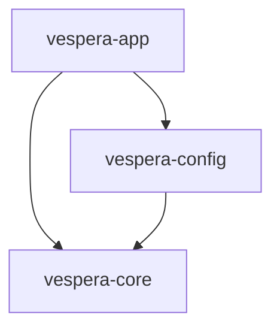
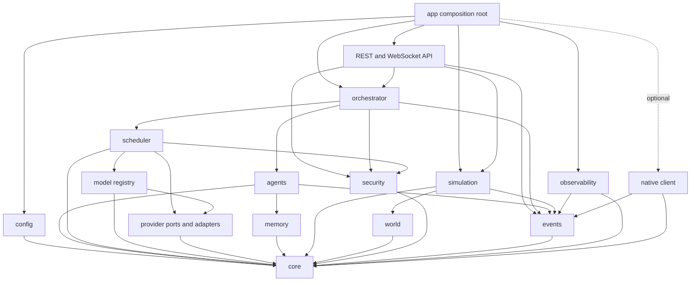

# Architecture

## Scope and status

VESPERA is a local-first Rust environment for interchangeable intelligence providers, independently identified agents, and eventually simulation. This build is limited to **Milestones 0 and 1**. The foundation consists of `vespera-core`, `vespera-config`, and `vespera-app`; later components below are design proposals, not installed services. Completion evidence and exact test results belong in the parent project's implementation report, not this architecture document.

The current foundation includes typed domain contracts, strict configuration validation, and the `validate-config` and `doctor` CLI commands. It does **not** connect to providers, resolve credentials for inference, load models, execute agents or tools, persist memory, schedule work, publish events, start an API server, or render a world. Event envelopes are data types, not an event bus; resource calculations are pure checked arithmetic, not a scheduler; memory namespaces are addressing types, not a database.

## Current dependency graph

An arrow means “depends on.” Only these three crates belong to the current workspace architecture.



`vespera-core` owns typed UUID identities, extensible validated capability strings, model metadata, independent agent definitions, replaceable fixed-model or capability-based selection policies, default-deny permission declarations, agent-owned memory addressing, legal task transitions, checked budget calculations, and versioned event envelopes. It contains no provider I/O, database, asynchronous executor, or resource-admission loop.

`vespera-config` parses strict TOML, rejects unknown fields and invalid values, detects duplicate identities, and resolves provider/model/agent references. Provider endpoint policy defaults to loopback; remote access requires explicit opt-in. Credentials may be referenced by environment-variable name, never embedded as plaintext or URL credentials. Parsing does not contact endpoints or verify secret values.

`vespera-app` composes configuration and domain types. `validate-config` checks the supplied file and reports a truthful summary; it does not test connectivity. `doctor` reports read-only observations of the current host without provider or network calls. A configured endpoint is not a connected provider, and a valid model entry is not a runnable model.

## Future dependency graph — draft

These are responsibility boundaries, not instructions to create empty crates. Names and port placement may be refined when a milestone supplies working behavior. Arrows remain compile-time dependencies; runtime messages can travel in either direction through defined ports without introducing a dependency cycle.



Provider adapters must not depend on the orchestrator. Storage must not import the agent execution loop. Simulation emits intents and consumes authorized results; it must not require synchronous inference to advance. The optional client consumes observations and submits authorized commands through the future API rather than owning orchestration. App wiring selects implementations and passes ports. A future Rust SDK shares wire contracts, not application internals.

Tokio is the future asynchronous execution candidate; Axum REST and WebSockets are the selected future API direction. No gRPC implementation is planned now. SQLite is the first structured memory target. Bevy/wgpu are optional future native Rust presentation choices. VESPERA requires no JavaScript or Python runtime; independently developed external agents may use other languages without becoming backend dependencies.

## Identity, registry, and residency

Provider, model, agent, task, and event IDs identify different entities. Agent IDs and memory namespaces are never derived from a model name or provider. The user/control plane owns agent identity and permissions; changing the model policy does not create a new agent or erase its history. Configured capabilities describe intended eligibility, not proof of competence or access rights.

A registry is metadata, not a residency reservation. There is no hardcoded model-count limit, and registering many models must not load them. Discovery, endpoint health, model availability, load state, active inference, and telemetry are separate observations. Future adapters must explicitly distinguish supported, unsupported, and unknown lifecycle controls. A timeout or lost connection cannot prove that remote computation stopped.

## Resource limits and clocks

The initial sandbox assessment recorded approximately 7.8 GiB RAM, six logical CPU threads, no exposed NVIDIA/DRM GPU device, and stable Rust 1.99.1. These are observations of this sandbox, not specifications of the user's computer. No exposed GPU is not a measured zero-VRAM capacity. RAM and VRAM estimates can remain unknown. `doctor` must preserve this uncertainty rather than invent model-fit claims.

The foundation checks arithmetic overflow and budget boundaries. Future admission must separately account for model weights and quantization, context length, KV cache growth, batching/concurrency, runtime scratch space, provider-global allocations, operating-system needs, and configurable headroom. RAM and each device's VRAM are different budgets; neither is interchangeable with the other. Unknown estimates require an explicit conservative policy or measurement, not substitution with zero. Defaulting to one active inference is a conservative configuration limit, not a throughput guarantee.

Keep three clock domains separate: wall time for human-facing audit timestamps; monotonic elapsed time for timeouts, health age, leases, and latency; and logical simulation ticks for world evolution. Wall clocks may jump, and monotonic values do not survive restarts or compare across hosts. Future leases therefore need server-authoritative expiry with restart/fencing rules. Simulation pauses or advances independently of inference; late model results are validated against their originating world version rather than silently rewriting the present.

## Trust boundaries and observability

Configuration is a user-controlled trust boundary, not model output. Default-deny declarations in core are not yet runtime enforcement. Future enforcement must recheck principal, namespace, tool, network, delegation, and resource permissions at each side-effect boundary. Providers, retrieved memory, tool results, and external agents are untrusted inputs. None can grant permissions or replace system-owned identity. Loopback is a network restriction, not authentication; local processes are not inherently trusted.

Credential values must never enter events, logs, error URLs, memory, or experiment exports. Remote connections require opt-in and future transport/authentication safeguards; redirects and DNS rebinding need checks at connection time, beyond offline URL validation. Future API/storage/client views require authorization and redaction, even on a local host.

Observable reasoning workflows mean task routing, tool decisions, explicit summaries, inputs/outputs permitted by policy, and measurable execution events. They do **not** mean exposing a model's private hidden chain-of-thought. Agent statements are generated claims, not verified telemetry. Event retention, replay, backpressure, schema evolution, and persistence failures are future responsibilities detailed in [PROTOCOL.md](PROTOCOL.md).

## Basis

This document specializes [INITIAL_PLAN.md](INITIAL_PLAN.md) and the supplied [MASTER_DIRECTIVE.txt](MASTER_DIRECTIVE.txt). The plan's Cargo workspace, TOML, and official Rust installation references remain the baseline references; no provider API compatibility is asserted from those sources. See [PROVIDERS.md](PROVIDERS.md), [AGENTS.md](AGENTS.md), [MEMORY.md](MEMORY.md), and [ROADMAP.md](ROADMAP.md) for focused contracts and acceptance gates.

## Implemented foundation details

Configuration schema version 1 defaults to a user-declared 4 GiB RAM budget, zero VRAM budget, one concurrent inference, and a 4,096-token per-request context limit. A zero **configured VRAM budget** is intentional CPU-only policy, distinct from unknown observed VRAM or an omitted model estimate. `ResourceEstimate` uses optional RAM/VRAM values. `ResourceBudget::admit` computes checked prospective RAM/VRAM usage, adds one inference, and checks per-request context; it neither mutates usage nor reserves anything. Callers must supply complete known costs, including headroom/overhead. There is no scheduler or resource-release operation yet.

`doctor` reports OS/architecture, process-available CPU threads, Linux host RAM evidence, root cgroup-v2 limit evidence, and exposed GPU device paths. VRAM stays unknown and GPU telemetry is explicitly unimplemented. Host RAM may differ from container capacity, and root cgroup files may not represent a nested process cgroup; these observations cannot establish effective model capacity.

From the workspace root, the current command forms are:

```sh
cargo run -p vespera-app -- validate-config --config config/local.toml --json
cargo run -p vespera-app -- doctor --json
```

The application itself performs only configuration reads or host observations; Cargo may compile the workspace before running it. Detailed loopback, remote-HTTP opt-in, URL, and credential-reference rules are in [PROVIDERS.md](PROVIDERS.md).
