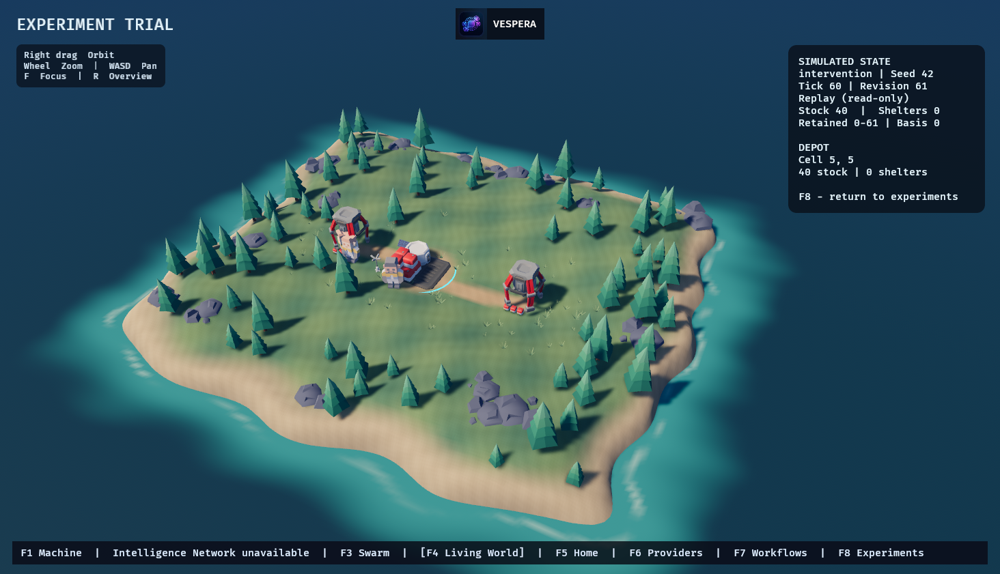

# Vespera Nexus Studio on Microsoft Store

Vespera Nexus Studio is the reserved Microsoft Store name for Vespera. The owner supplied Store product ID `9PNV5XMS74FW` and reported that the product is in draft. The repository and application branding use Vespera.

## Confirm the package identity

Open the [Vespera Nexus Studio draft](https://partner.microsoft.com/en-us/dashboard/products/9PNV5XMS74FW/overview) in the owner's signed-in Partner Center session. Under **Product management → Product identity**, copy these fields exactly. [Microsoft identity reference](https://learn.microsoft.com/windows/apps/publish/view-app-identity-details)

| Partner Center field | Local JSON field |
| --- | --- |
| Store ID | `storeProductId` |
| Package/Identity/Name | `name` |
| Package/Identity/Publisher | `publisher` |
| Package/Properties/PublisherDisplayName | `publisherDisplayName` |
| Package Family Name | `packageFamilyName` |

Also confirm that **Packages** accepts a Windows Desktop x64 MSIX for this draft. No authenticated Partner Center session or provisioned submission API was available during development. Keep the identity JSON in an operator-controlled location, such as `target/store-identity.json`. It contains identity metadata only. Microsoft account credentials and tokens belong in the owner's authorized authentication flow. The build checks the supplied family against the Windows-derived family for the exact name and publisher before staging any files. [Windows package identity](https://learn.microsoft.com/windows/apps/desktop/modernize/package-identity-overview)

## Build an unsigned MSIX

Use PowerShell 7 on a Windows x64 host with the pinned Rust toolchain, MSVC build tools, Windows SDK MakeAppx and Manifest Tool. Run from the repository root.

```powershell
./scripts/package-windows-store.ps1 -Development -Version 1.0.0.0 -Output target/store-development
./scripts/package-windows-store.ps1 -IdentityFile target/store-identity.json -Version 1.0.0.0 -Output target/store-candidate
```

Each output directory must be new. Development uses a separate package family and a visible **Development** label in the Start Menu. The Store path requires a clean checkout and the actual identity file. Both build the optimized locked Rust/Bevy desktop, stage an explicit payload, validate and unpack it with MakeAppx, compare staged and unpacked hashes, and emit the unsigned MSIX, a 300×300 Store listing tile and build evidence. The Store package version is independent of the Rust application version. Start at `1.0.0.0` only if Partner Center confirms it is available. Increase the version for upgrades and leave the fourth component at zero. [Microsoft package version rules](https://learn.microsoft.com/windows/apps/publish/publish-your-app/app-package-requirements?pivots=store-installer-msix)

| Package decision | Behavior |
| --- | --- |
| Native entry point | Windows launches the optimized `vespera-view.exe` directly. Vespera's MSI and portable launcher keep their existing entry points. |
| Runtime | Full-trust packaged desktop app at medium integrity, with `runFullTrust` and the Microsoft Visual C++ Desktop framework dependency. The MSIX does not bundle a driver or model server. |
| Storage | WinRT `ApplicationData.LocalFolder` supplies the package's per-user LocalState. A package upgrade keeps the family and data. Copy backed-up data explicitly when migrating between the classic and Store distributions. Export important data before removing the MSIX. |
| Provider access | The desktop uses its existing loopback provider declarations and credential references. The provider daemon is installed and managed independently. No firewall rule, AppContainer loopback exemption or external executable installation is part of the MSIX. |
| Child processes | The package starts the viewer directly. The standalone updater and its Setup handoff are excluded from the Store viewer at build time. |
| Display scaling | The Store executable embeds a PerMonitorV2 DPI declaration. The packager checks the embedded Win32 manifest before creating the MSIX. |
| Operating system | The manifest targets Windows Desktop x64 with a Windows 10 build 19041 API floor. Test the current supported Windows editions and drivers separately before declaring support. |

The existing Windows MSI, Setup EXE and portable ZIP have their own release pipeline. Microsoft Store package signing occurs through the Store workflow and applies to the Store package. [MSIX container behavior](https://learn.microsoft.com/windows/msix/msix-containerization-overview) · [Desktop CRT framework](https://learn.microsoft.com/troubleshoot/developer/visualstudio/cpp/libraries/c-runtime-packages-desktop-bridge) · [MSIX signing](https://learn.microsoft.com/windows/msix/package/signing-package-overview)

## Development installation

Use an isolated Windows test machine or disposable test user with the required x64 VCLibs framework. Build two versions under the development identity, for example `1.0.0.0` and `1.0.1.0`. Sign copies with the same non-exportable development code-signing certificate whose subject matches the manifest. Trust its public certificate in Local Computer **Trusted People** for the test. Remove the isolated test package and temporary certificate when finished. Keep the unsigned originals for verification. [Microsoft development-signing procedure](https://learn.microsoft.com/windows/msix/package/sign-msix-package-guide)

Install using `Add-AppxPackage`, open **Vespera Nexus Studio (Development)** from Start, and check the branded Home frame. Exercise provider discovery, inference, agent and workflow execution, retained memory, simulation, close and restart. Upgrade using the newer MSIX and confirm the same package family, retained revision, settings and owned records. Run the Windows App Certification Kit on the candidate and retain its report separately from functional evidence.

The Windows development rehearsal built and unpacked both versions with SDK 10.0.26100.0. SignTool signed isolated copies with a temporary non-exportable certificate. Windows installed both versions and started the branded native viewer from the package identity. A fresh profile committed a Living World tick, discovered an Ollama-protocol loopback fixture, registered two agents, and completed a two-agent workflow. It recalled the first agent's owned response in a later provider request. Swarm showed two agents and three observed links from the committed journal. The upgrade reopened world revision 1 and preserved the world, task, workflow and memory database bytes. The development package and certificate were removed after each run.

At `0767da1173e0c3f928dae5b03efe98282d1187b9`, the installed viewer opened the intervention replay at tick 60, selected the depot and panned the camera. After upgrading to `1.0.1.0`, it reopened the saved baseline replay and the committed live world. The world and all six retained trial databases matched their pre-upgrade SHA-256 hashes. The Windows App Certification Kit passed all 24 checks on the signed development MSIX file, with no warnings and no partial run. The test package and temporary certificate were removed. The refreshed Windows x64 Store SBOM passed CycloneDX 1.6 schema validation. OSV returned zero matches for the 429 exact Cargo versions queried. The attribution and independent distribution review remain open.

| 3D preview unsigned development package | SHA-256 |
| --- | --- |
| MSIX `1.0.0.0` | `ce9ad332837ba797baa1dce6957862c2db2e8eb830fce970c705a852f42c08c6` |
| MSIX `1.0.1.0` | `8afe0a79fc1a91d694659dae35c024a73c545fc9108acbf7f41a9b97a222ead4` |
| Internal development review ZIP | `6c610b8907a6f8f8bfea8db2c5c96fda51c5fb3f16caf8c326ecbd185447d3ab` |

Two additional installed rehearsals exercised real inference and workflow recovery. Ollama 0.40.15 on the Windows test host ran `hermes3:8b` through the packaged viewer. The completed task reported 103 output tokens and the provider confirmed the model was absent after cleanup. A controlled loopback fixture then stopped the viewer after its first workflow attempt committed. Restart continued the same workflow with the original committed attempt and one new provider request. Upgrade again preserved the world, tasks, workflow and memory bytes.

The first Windows App Certification Kit report returned **Warning**. The DPI check could not verify the viewer and the optional blocked-executables check flagged its process-launch import. The next build embeds PerMonitorV2 and excludes the standalone updater. Windows Manifest Tool extracted the declaration from the installed executable and the native window reported PerMonitorV2. PE import inspection confirmed that `CreateProcessW` was absent. The kit's installed-package run cleared the blocked-executables check and still reported a DPI warning. A second run against the signed MSIX file reported **Pass**, with 24 passed tests and no warnings, including DPI awareness. The same clean build ran `hermes3:8b` through Ollama 0.40.15 and retained its 111-token task result and world through upgrade. The package family used for these tests is the development identity. Microsoft Store certification and the actual Partner Center identity remain open.

The clean-source development packages used for the signed-file check came from `5d19b001a32faadd62d4ce5176ebc42a475074fd`. Both MakeAppx payloads and their embedded Win32 manifests verified. Windows App Certification Kit 10.0.26100.7705 reported the result on Windows 11 build 26300. The test package and temporary signing certificate were removed afterward.

| Revised unsigned development package | SHA-256 |
| --- | --- |
| MSIX `1.0.0.0` | `780afdef130424448b49ed1591a227c5af392c27046f8d5b5d941ad2e25ed09b` |
| MSIX `1.0.1.0` | `bb6587e43f773885f039f10cc650e74bc5b876aca51a3dfc6756fba305910097` |
| Revised development review ZIP | `8b7a3bc5fd63dc19be524b857d0a388294de091d46a2d895d2ba889b782a27d4` |

The original clean-source unsigned packages were built at `399c2d015eae6aac506dcd02624a6caba258085c`. Both had 14 payload files verified through MakeAppx and the upgrade payload matched the installed test payload. The internal review ZIP contains the development package, listing tile, screenshot, CycloneDX 1.6 SBOM and collected notices. OSV returned zero matches for the 429 exact Cargo versions queried.

| Internal artifact | SHA-256 |
| --- | --- |
| Development MSIX `1.0.0.0` | `e023014df87ae78703928cac8cc13acef07955e389c2768c6c431165d93f183d` |
| Development MSIX `1.0.1.0` | `b66d5bfabfb3105125ccb11956e26af0d4023483264f72dfa3ff2356c46b8d0f` |
| Development review ZIP | `0702bc40f95a4eac46c29cd61009ffbba863798de6a58ee96a0c4e321c55d5b1` |

## Draft Store listing

**Description**

Vespera Nexus Studio is a local-first workspace for AI models, agents, and simulated worlds. Connect a compatible local model server, assign models and roles to agents, and run workflows whose inputs, results, and ownership can be inspected. Explore a persistent 3D settlement and compare repeatable simulation outcomes using saved trials.

**Feature list**

- Discover models on local Ollama and OpenAI-compatible endpoints.
- Configure agent roles, model bindings, and explicit permissions.
- Author workflows with dependencies and inspect retained results.
- Keep permission-scoped agent memory and local message history.
- Inspect observed activity in Swarm and view host resources in Machine.
- Run Living World, replay saved revisions, and compare starter-world policies.

**Requirements and accessibility**

Windows x64 and a working graphics driver for Bevy/wgpu rendering. Model inference requires a separately running compatible provider and enough memory for the chosen model. Windows GPU and driver combinations beyond the recorded validation scope require qualification. Home and Atlas provide keyboard navigation and a reduced-motion setting. Screen-reader coverage and accessibility certification remain pending.

**Visual assets**

Use the generated listing tile and native package captures. The 1464×841 Living World image below comes from the installed development MSIX after committing the first simulation tick. Caption it “Living World shows a committed simulation revision and interactive resident and resource inspection.” Capture remaining views at 1366×768 or larger in PNG. Label fixture activity where shown and exclude account information, filesystem paths, private prompts and credentials. [Microsoft screenshot requirements](https://learn.microsoft.com/windows/apps/publish/publish-your-app/msix/screenshots-and-images)


The installed development package also captured the depot inspector during a verified experiment replay. The overlay identifies the intervention, seed, tick and revision and labels the state as read-only.



**Privacy and permissions review**

Prompts, responses, settings, task history, messages, memory and world data are stored locally when the relevant feature is used. An explicitly configured provider receives the task inputs it needs, which can include selected memory or preceding workflow outputs. The desktop reads host resource information for Machine and can read user-provided clipboard text during editing. The application uses full trust to run the native renderer, access its local SQLite files, and reach operator-configured local services. Review third-party notices against the MSIX payload and resolve outstanding rights and attribution before distribution. [Privacy and support requirements](https://learn.microsoft.com/windows/apps/publish/publish-your-app/msix/support-info) · [Vespera release review](RELEASE.md)

**Proposed support URL for owner review** [Vespera issue tracker](https://github.com/ShamelesAbyss/Vespera/issues)

**Draft privacy text for owner review**

> Vespera Nexus Studio stores the work you create and the settings you choose in your Windows user profile. When you run an inference task, Vespera sends the prompt and any context you authorize to your selected model provider. Context can include saved memory or earlier workflow results. Your provider controls how it processes and retains that input. Vespera reads local hardware information for the Machine view and reads clipboard text when you paste it into an editor. Windows manages the installed package and its updates. If you report a problem through the public issue tracker, include only the details you want to make public. Keep backups of your work before removing the application.

The privacy text, disclosure answers and support route need owner review before submission.

## Prepare the submission

Use **Packages** in the authenticated draft to validate the manifest and upload a candidate after review. Complete Store listings, Properties, Age ratings, Privacy and support, availability and certification notes. An authorized Entra application associated with Partner Center can use the MSIX submission API for read and draft operations. Its documented read endpoint is `GET https://manage.devcenter.microsoft.com/v1.0/my/applications/{applicationId}`. Use the app ID returned by the authorized account listing. Provisioning access and credentials requires the owner's authorized workflow. Keep upload links and credentials out of logs and source. Final public submission, legal agreements, new persistent access and costs require owner authorization. [Read application data](https://learn.microsoft.com/windows/uwp/monetize/get-app-data) · [Create an MSIX submission](https://learn.microsoft.com/windows/apps/publish/publish-your-app/msix/create-app-submission)
