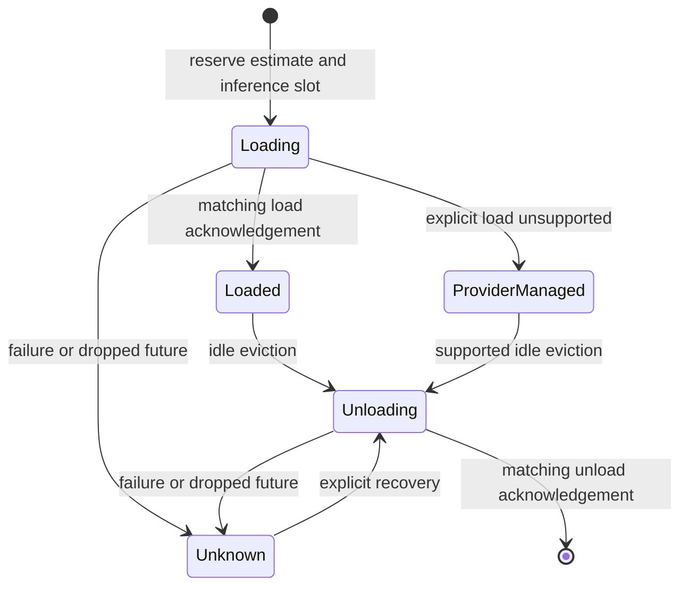

# Scheduler lifecycle and accounting

`vespera-scheduler` admits library requests using explicit RAM/VRAM estimates,
context limits, and a concurrency budget. It starts empty and does not activate
the registry inventory. These are local reservations, not physical measurements.

## Lifecycle coordination

Each model has its own asynchronous gate. The global accounting mutex protects
only synchronous state changes and is never held during provider I/O. Requests
for a loading or unloading model wait for that model's gate. Other models and
usage snapshots remain accessible.



`Loaded` means an explicit load was acknowledged, not that the estimated memory
was measured. `ProviderManaged` means physical residency is unverified. `Unknown`
is charged but cannot be reused until unloaded. Unsupported unload returns an
error without releasing memory. An acknowledgement must name the expected
provider and model.

A synchronous transition guard marks interrupted lifecycle operations unknown.
During an interrupted load it also releases the local inference slot. It never
assumes that dropping a request stopped remote work or freed provider memory.

## Startup residency reconciliation

Before its first admission, a new scheduler can call `reconcile_startup` to
observe residency from every provider in its scoped registry. It rejects
unsupported telemetry, inconsistent snapshots and cancelled observations before
installing a baseline. Ollama reads [running model residency](https://docs.ollama.com/api/ps).

Models already resident at startup stay under external ownership. Admission
charges their reported RAM and VRAM against available headroom and rejects
requests for those same model names, including equivalent Ollama names.
Eviction and shutdown cleanup operate only on local reservations. The startup
report keeps provider observations separate from local accounting.

The baseline is a point-in-time observation held in process memory. Provider
changes after sampling can invalidate its assumptions. Shared backends reached
through multiple provider registrations may be counted more than once. Use a
single registration per backend for meaningful aggregate memory.

## Current limits

Both estimate dimensions must be known. CPU-only models use explicit zero VRAM.
Supply estimates for memory that can remain resident and leave room for
system overhead. Automatic KV-cache estimation, continuous telemetry
reconciliation and automatic shutdown unloading remain open.

## Per-inference memory allowance

The optional `[inference_overhead]` table supplies fixed and per-context-token
RAM and VRAM allowances. Every field defaults to zero. The same policy applies
to all providers composed from that configuration.

```toml
[inference_overhead]
ram_bytes = 33554432
ram_bytes_per_context_token = 0
vram_bytes = 0
vram_bytes_per_context_token = 65536
```

These values illustrate the units. Use values established for the deployed
provider, model and concurrency limits. Each admission adds the fixed
allowance plus the per-token allowance multiplied by the request's context
ceiling. This charge applies during preparation and while the local lease is
held, including model reuse. Release, cancellation and failed preparation
return the transient allowance once. Keep memory that may remain allocated
after local execution ends in the model estimate, including persistent KV
allocation. The allowance does not measure backend memory or prove that
remote computation has stopped.

Scheduler telemetry includes active allowances in aggregate reserved RAM
and VRAM. Individual model rows show the model reservation estimate. Under
memory pressure, eviction skips candidate models whose lifecycle gate is
already held by another operation.

## Inference lease ownership

Each admission creates a private UUID-backed lease. `ScheduledInference` clones
share that lease; they do not create additional inference reservations.
`ScheduledInference::release()` returns the local slot once, and dropping the
last clone returns an unreleased slot synchronously. Neither action unloads the
model. Model-ID-based release has been removed so a caller cannot accidentally
release another admission for the same model. The runtime retains its own lease
handle and validates task/model ownership before completing a task. A local slot
release does not establish that provider-side computation stopped.

## Bounded queue and shutdown

`SchedulingPolicy.queue` defaults to 64 waiting requests and at most eight
priority bypasses. Granted requests (including preparation) are independently
bounded by `max_concurrent_inferences`. `admit_and_prepare` uses priority zero;
`admit_with_priority` accepts a `u8`, with larger values preferred. Equal
priorities are FIFO. After the configured number of bypasses, the oldest
eligible waiter is selected before newer high-priority arrivals. Capacity zero
allows immediate free-slot admission but rejects waiting.

Cancelled or dropped waiting futures remove their tickets synchronously. Queue
permits follow inference lease lifetime, so preparation errors and handle drop
return capacity. Waiting on a per-model lifecycle gate also consumes a granted
permit; this is conservative and can reduce throughput for same-model bursts.
Memory/context admission errors remain typed failures after a queue permit is
granted; the queue does not hide impossible model costs with endless retries.

`queue_snapshot()` reports waiting/granted counts separately from inference and
memory accounting. `shutdown(timeout)` closes new/queued admissions and waits a
bounded time for granted permits to return. `false` means active local work
remains. Shutdown does not forcibly cancel existing provider calls or unload
models. Idle/uncertain reservations remain inspectable and can be explicitly
evicted after shutdown. Reopening admission requires a new scheduler; persisted
restart reconciliation is still future work.

## Tests

```powershell
cargo test -p vespera-scheduler --locked
```

The deterministic fake provider covers admission, reuse, acknowledged pressure
eviction, unsupported/failed/unacknowledged unload, coordinated loading, failed
load, and task abort during load or unload. It does not prove live model fit.

Scheduler-driven native Ollama preload carries the admitted context, matching
native inference. A live 512-token run reported a 512-token allocation. See
[the captured evidence](../artifacts/live-ollama-context-2026-11-06.json).

An explicitly loaded reservation can be reused at the same requested context.
A different context requires an idle reservation and an acknowledged unload
before preload. A context change during an active local lease returns a typed
error. Failed unloads retain the reservation. Provider-managed reservations
continue to have unverified allocation. Include any retained context allocation
in the model estimate and account separately for transient inference overhead.

The request-aware admission API accepts a validated bounded request, checks its native model name against current inventory, and admits exactly its context. A mismatch or context/budget rejection occurs before model load. Managed agents use this path after preflight; manual admission does not itself validate a future inference payload.
