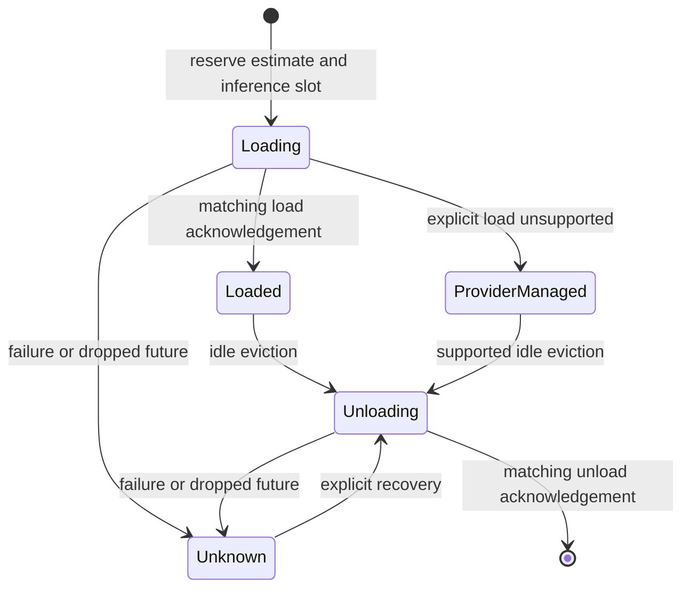

# Scheduler lifecycle and accounting

`vespera-scheduler` admits library requests using explicit RAM/VRAM estimates,
context limits, and a concurrency budget. It starts empty and does not activate
the registry inventory. These are local reservations, not physical measurements.

## Lifecycle coordination

Each model has its own asynchronous gate. The global accounting mutex protects
only synchronous state changes and is never held during provider I/O. Requests
for a loading or unloading model wait for that model's gate. Other models and
usage snapshots remain accessible.



`Loaded` means an explicit load was acknowledged, not that the estimated memory
was measured. `ProviderManaged` means physical residency is unverified. `Unknown`
is charged but cannot be reused until unloaded. Unsupported unload returns an
error without releasing memory. An acknowledgement must name the expected
provider and model.

A synchronous transition guard marks interrupted lifecycle operations unknown.
During an interrupted load it also releases the local inference slot. It never
assumes that dropping a request stopped remote work or freed provider memory.

## Startup and admission residency reconciliation

Before its first admission, a new scheduler can call `reconcile_startup` to
enable residency reconciliation and capture a baseline. Every subsequent
admission takes a fresh snapshot across the same provider scope. Unsupported
telemetry, inconsistent snapshots and cancelled probes fail before activation.
Ollama reads [running model residency](https://docs.ollama.com/api/ps).

Admission charges RAM and VRAM reported for externally resident models
against available headroom. It rejects requests for those names, including
equivalent Ollama names. A locally acknowledged load on the same provider
and model name keeps its local estimate. A second registry identity cannot
claim that reservation. Uncertain reservations stay charged and reconciliation
mode excludes them from automatic unload. After the provider operator resolves
uncertain residency, start a new runtime to resample it. Reports keep observed
pressure separate from local accounting.

Opt-in preparation and unload are serialized around the probe and lifecycle
transition. Inference can continue concurrently. Observations are held in
process memory. They cannot identify a separate client replacing a model under
the same name or detect changes between samples. Shared backends reached
through multiple provider registrations may be counted more than once. Use a
single registration per backend for meaningful aggregate memory.

## Durable restart recovery

`--residency-journal <PATH>` opts `run-agent` or `run-workflow` into a private
SQLite journal and requires `--reconcile-residency`. Use one journal and
stable provider IDs for a resource pool. An invocation holds an exclusive
database connection, and another invocation using the same file fails
before reaching the provider. The journal stores provider IDs, canonical
model names and resident memory estimates.

The scheduler commits a record before model activation and removes it after
an acknowledged unload. Any surviving records fence those model names on
reopen, even if the first probe reports no residency. A prior request could
still finish after that probe. A recovered record with no matching provider
observation keeps its estimated RAM and VRAM charged. A matching observation
contributes the provider's reported memory. Recovery never takes ownership
of a model reported by the provider.

Once the provider operator has confirmed that earlier work has stopped,
pass `--acknowledge-residency-recovery` on the next invocation. It clears
only records for scoped providers whose current snapshot omits the recorded
model. Resident and out-of-scope records stay fenced. The JSON field
`recovered_reservations` counts retained records from earlier invocations.
Use a private local filesystem path. Different journal files and independent
provider clients have separate ownership boundaries.

## Current limits

Both estimate dimensions must be known. CPU-only models use explicit zero VRAM.
Supply estimates for memory that can remain resident and leave room for
system overhead. Automatic KV-cache estimation, observation during active
requests and automatic shutdown unloading remain open.

## Per-inference memory allowance

The optional `[inference_overhead]` table supplies fixed and per-context-token
RAM and VRAM allowances. Every field defaults to zero. The same policy applies
to all providers composed from that configuration.

```toml
[inference_overhead]
ram_bytes = 33554432
ram_bytes_per_context_token = 0
vram_bytes = 0
vram_bytes_per_context_token = 65536
```

These values illustrate the units. Use values established for the deployed
provider, model and concurrency limits. Each admission adds the fixed
allowance plus the per-token allowance multiplied by the request's context
ceiling. This charge applies during preparation and while the local lease is
held, including model reuse. Release, cancellation and failed preparation
return the transient allowance once. Keep memory that may remain allocated
after local execution ends in the model estimate, including persistent KV
allocation. The allowance does not measure backend memory or prove that
remote computation has stopped.

Scheduler telemetry includes active allowances in aggregate reserved RAM
and VRAM. Individual model rows show the model reservation estimate. Under
memory pressure, eviction skips candidate models whose lifecycle gate is
already held by another operation.

## Inference lease ownership

Each admission creates a private UUID-backed lease. `ScheduledInference` clones
share that lease; they do not create additional inference reservations.
`ScheduledInference::release()` returns the local slot once, and dropping the
last clone returns an unreleased slot synchronously. Neither action unloads the
model. Model-ID-based release has been removed so a caller cannot accidentally
release another admission for the same model. The runtime retains its own lease
handle and validates task/model ownership before completing a task. A local slot
release does not establish that provider-side computation stopped.

## Bounded queue and shutdown

`SchedulingPolicy.queue` defaults to 64 waiting requests and at most eight
priority bypasses. Granted requests, including preparation, are independently
bounded by `max_concurrent_inferences`. Managed and default manual admissions
use the configured model priority, which defaults to zero. The library's
`admit_with_priority` accepts an explicit `u8` override for the queue.
Larger values win and equal priorities are FIFO. After the configured number
of bypasses, the oldest eligible waiter is selected. Capacity zero allows
immediate free-slot admission and rejects waiting.

Configure the runtime with an optional TOML table.

```toml
[scheduling]
queue_capacity = 64
max_priority_bypasses = 8
keep_alive_seconds = 300
evict_idle_on_pressure = true

[scheduling.model_priorities]
"22222222-2222-4222-8222-222222222222" = 20
```

Queue capacity and bypasses accept 0–4,096. Zero bypasses selects FIFO.
Pressure eviction prefers idle models with lower configured priority,
then the least recently admitted among ties. Set
`evict_idle_on_pressure = false` to reject work that would require eviction.
This setting applies to memory pressure. An idle context change still needs
an acknowledged unload before reload. Priorities refer to the effective
inventory, including a selected durable catalog. Capability matching and
agent model policies govern model selection.

`keep_alive_seconds` accepts 1–86,400 seconds. Native Ollama receives it on
preload and inference. With the setting omitted, preload requests 300 seconds
and inference uses the provider default. Compatible APIs lack a portable
retention hint. An explicit cleanup unload overrides the requested retention.

### Local host limits

Set `local_host_limits = true` in `[scheduling]` to tighten the declared
budget at runtime startup. This opt-in requires loopback providers in the
runtime's selected scope. It caps RAM by available physical memory and, on
Linux when observed, this process's cgroup headroom. It caps inference slots
by the process's available parallelism. Startup fails when positive RAM and
CPU capacity cannot be established.

`run-agent --json` and `run-workflow --json` include the observations and
effective ceilings in `local_host_limits`. Scheduler telemetry publishes the
effective budget. These are startup observations and can change while the
runtime is active. A loopback proxy or a provider running in a different
cgroup may have different limits. External provider reservations are still
charged by residency reconciliation, which can conservatively reduce
headroom already reflected in the host sample. The VRAM budget remains the
operator declaration because the runtime cannot identify the provider's
actual GPU capacity from the host sample.

### Observed latency preference

Set `prefer_observed_latency = true` in `[scheduling]` to rank models for
managed capability-based execution. Fixed model assignments and workflow
agent ordering still apply. The scheduler times successful provider calls
locally, excluding Vespera's queue and explicit preload. It keeps up to 128
observations per runtime. For each eligible model, it compares the median
of up to three observations from the last 15 minutes at the same context
ceiling and requested output limit.

Ranking requires evidence for every candidate in the comparison, the same
provider adapter binding, and sufficient declared resources for each
candidate to fit by itself. Otherwise the runtime uses stable model-ID
ordering. Matching bounds allow a comparison, while prompt complexity,
actual output length and backend load can still affect timings. The
preference offers no deadline guarantee. A workflow can collect evidence
from its existing fixed-model workers before a capability-based step.

Cancelled or dropped waiting futures remove their tickets synchronously. Queue
permits follow inference lease lifetime, so preparation errors and handle drop
return capacity. Waiting on a per-model lifecycle gate also consumes a granted
permit; this is conservative and can reduce throughput for same-model bursts.
Memory/context admission errors remain typed failures after a queue permit is
granted; the queue does not hide impossible model costs with endless retries.

`queue_snapshot()` reports waiting/granted counts separately from inference and
memory accounting. `shutdown(timeout)` closes new/queued admissions and waits a
bounded time for granted permits to return. `false` means active local work
remains. Shutdown does not forcibly cancel existing provider calls or unload
models. Idle/uncertain reservations remain inspectable and can be explicitly
evicted after shutdown. Reopening admission requires a new scheduler; persisted
restart reconciliation is still future work.

## Tests

```powershell
cargo test -p vespera-scheduler --locked
```

The deterministic fake provider covers admission, reuse, acknowledged pressure
eviction, unsupported/failed/unacknowledged unload, coordinated loading, failed
load, and task abort during load or unload. It does not prove live model fit.

Scheduler-driven native Ollama preload carries the admitted context, matching
native inference. A live 512-token run reported a 512-token allocation. See
[the captured evidence](../artifacts/live-ollama-context-2026-11-06.json).

An explicitly loaded reservation can be reused at the same requested context.
A different context requires an idle reservation and an acknowledged unload
before preload. A context change during an active local lease returns a typed
error. Failed unloads retain the reservation. Provider-managed reservations
continue to have unverified allocation. Include any retained context allocation
in the model estimate and account separately for transient inference overhead.

The request-aware admission API accepts a validated bounded request, checks its native model name against current inventory, and admits exactly its context. A mismatch or context/budget rejection occurs before model load. Managed agents use this path after preflight; manual admission does not itself validate a future inference payload.
