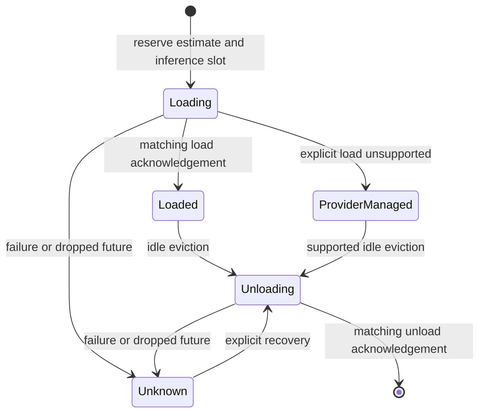

# Scheduler lifecycle and accounting

`vespera-scheduler` admits library requests using explicit RAM/VRAM estimates,
context limits, and a concurrency budget. It starts empty and does not activate
the registry inventory. These are local reservations, not physical measurements.

## Lifecycle coordination

Each model has its own asynchronous gate. The global accounting mutex protects
only synchronous state changes and is never held during provider I/O. Requests
for a loading or unloading model wait for that model's gate. Other models and
usage snapshots remain accessible.



`Loaded` means an explicit load was acknowledged, not that the estimated memory
was measured. `ProviderManaged` means physical residency is unverified. `Unknown`
is charged but cannot be reused until unloaded. Unsupported unload returns an
error without releasing memory. An acknowledgement must name the expected
provider and model. This process does not reconcile external provider activity.

A synchronous transition guard marks interrupted lifecycle operations unknown.
During an interrupted load it also releases the local inference slot. It never
assumes that dropping a request stopped remote work or freed provider memory.

## Current limits

Both estimate dimensions must be known; CPU-only models use explicit zero VRAM.
The caller must include overhead and headroom in supplied estimates. There is
no automatic per-request KV-cache costing, hardware discovery, telemetry
reconciliation, priority queue, or shutdown coordinator yet. See the development log for
checkpoint validation and the roadmap for the complete acceptance gates.

## Inference lease ownership

Each admission creates a private UUID-backed lease. `ScheduledInference` clones
share that lease; they do not create additional inference reservations.
`ScheduledInference::release()` returns the local slot once, and dropping the
last clone returns an unreleased slot synchronously. Neither action unloads the
model. Model-ID-based release has been removed so a caller cannot accidentally
release another admission for the same model. The runtime retains its own lease
handle and validates task/model ownership before completing a task. A local slot
release does not establish that provider-side computation stopped.

## Tests

```powershell
cargo test -p vespera-scheduler --locked
```

The deterministic fake provider covers admission, reuse, acknowledged pressure
eviction, unsupported/failed/unacknowledged unload, coordinated loading, failed
load, and task abort during load or unload. It does not prove live model fit.
