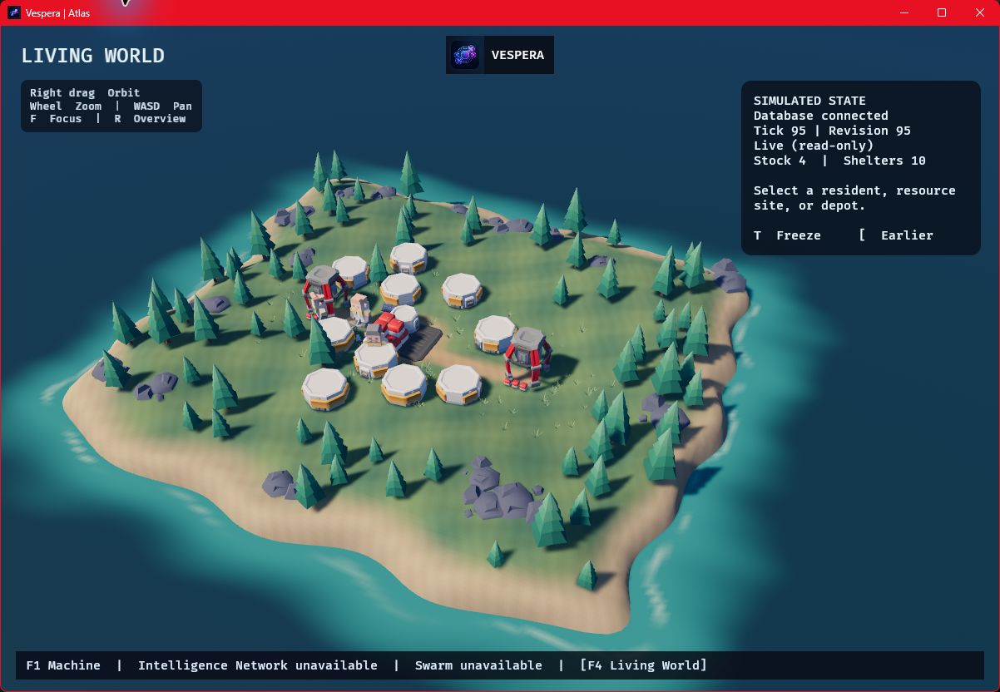
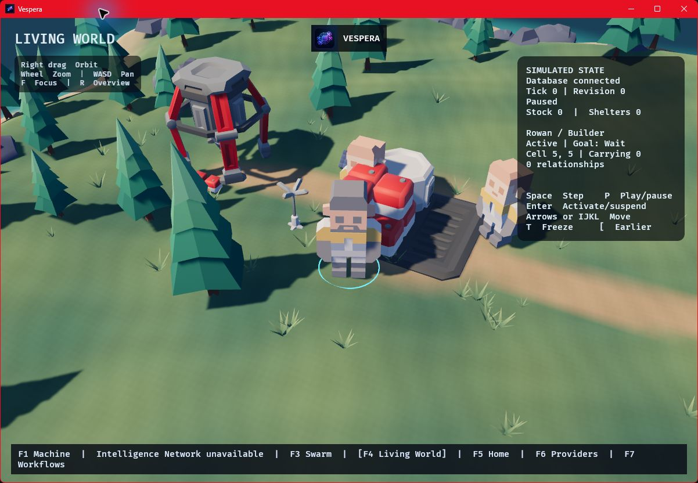

# Living World visuals

Living World draws a miniature island settlement from a committed world snapshot. The depot, resource drills, and suits are textured glTF models embedded in the Rust executable. An indexed heightfield carries the coastline, ridges, paths, and forest clearings. The camera uses filmic tone mapping and distance fog. Warm sunlight, cool ambient light, and filtered cascaded shadows make structures and terrain legible at different zoom levels. Shared meshes and materials allow Bevy to reuse render data across the island. See the [art credits](../assets/world/ATTRIBUTION.md).



*Native Windows capture of the example world at revision 95. The ten visible habitat modules reflect the committed shelter count.*

<details>
<summary>Resident inspection close-up</summary>



</details>

## Reading the scene

| Visual | Source |
| --- | --- |
| Depot and resource drills | Committed grid positions. Resource crates represent stock in three bands. The inspector shows the exact amount. |
| Habitat modules | Committed shelter count, with up to 12 modules arranged around the depot. Module locations are visual placements because the database stores the count. |
| Astronauts | Committed resident positions and roles. A small display offset keeps suits visible next to buildings. |
| Suit poses | Adjacent live position changes drive the walk cycle. Larger observed jumps go directly to the committed cell. Newly observed gathering and building memories drive short work poses. Frozen replay and reduced-motion mode show stationary poses. |
| Selection and reasoning rings | Cyan marks the selected entity. Amber marks reasoning preparation and violet marks active inference. Relationship lines are drawn for the selected resident's recorded contacts. |
| Terrain, vegetation, water and utility props | Presentation geometry. The grid remains authoritative for movement and resources. |

## Open and inspect

Open Living World from the native Home screen. You can also launch the [standalone viewer](CLI.md#persistent-world-simulation) with an initialized world database.

```powershell
cargo run --locked -p vespera-view --features graphics -- --world data/world.sqlite3
```

Right-drag to orbit, scroll to zoom, and use **WASD** to pan. Click a depot, resource drill, or resident to inspect it. **F** focuses on the selection and **R** returns to the overview. The timeline and commit controls retain their existing read-only and explicit-write modes.

Atlas can report update intervals and process RAM. Start Atlas with the world database, press **F4**, and keep the window focused through the sample. The report measures update intervals at the current window size.

```powershell
cargo run --locked -p vespera-view --features graphics -- --atlas --world data/world.sqlite3 --measure-frames 120
```

## Windows validation

Both fixtures were viewed at 1200×800 with the Windows development build on an NVIDIA GeForce RTX 4070 Laptop GPU (8 GB), using Vulkan and FIFO presentation. Atlas recorded 120 focused updates after 120 warmup updates. Windows reported 505.30 MiB of dedicated GPU memory for the process in one snapshot per fixture.

| Fixture | Scene | Median update interval | p95 | p99 | Process RAM |
| --- | --- | ---: | ---: | ---: | ---: |
| Example settlement | 12×10, 3 residents, 2 sites, 10 shelters | 10.75 ms | 11.63 ms | 12.06 ms | 565 MiB |
| Large world | 64×64, 32 residents, 64 sites | 11.27 ms | 12.66 ms | 13.34 ms | 573 MiB |

The frame intervals include the application update loop and presentation pacing. The sample covers a steady overview on one adapter. Load times, concurrent inference, other resolutions, and other GPUs require separate measurement.
